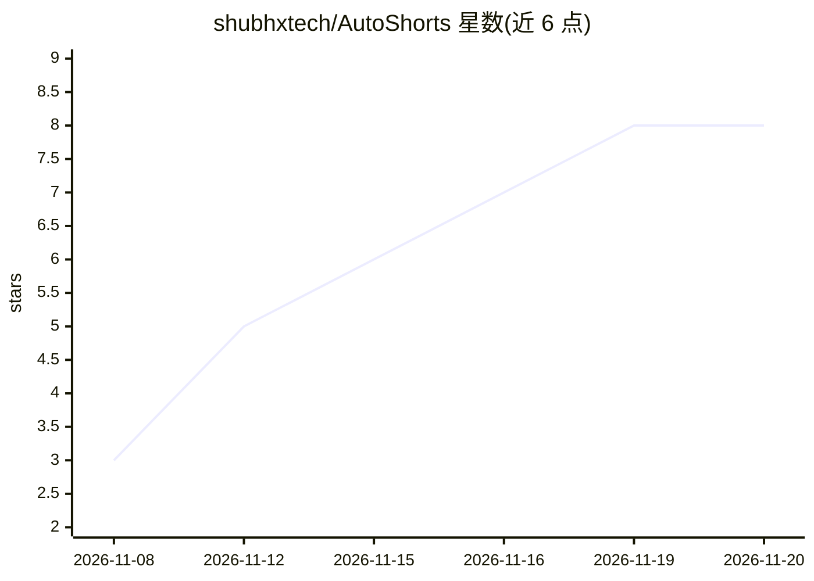

# shubhxtech/AutoShorts

⭐ 8 · Python · MIT · 推送 2026-10-25 · [GitHub](https://github.com/shubhxtech/AutoShorts) · 个人维护

**本地运行的开源工具：把长视频剪成可直接发布的短视频**

在用户本机运行的视频自动化工作室：粘贴有权使用的长视频链接后，通过 Whisper 转录、wav2vec2 对齐与本地 LLM 选取片段，生成 9:16 竖屏剪辑（动画字幕、hook 标题、缩放与跳剪），支持英语与印地语；也可按主题从头生成无脸视频（7 种格式，脚本基于 Wikipedia 事实核查）。成品经人工审核后通过官方 API 定时发布到 YouTube 与 Instagram。全部 AI 模型本地运行，无付费 API 与云端上传；提供 Docker 与原生安装路径，并附带 MCP server 供 AI 客户端调用。

## 筛选速览

| 维度 | 判定 | 备注 |
|---|---|---|
| AI 角色 | `ai-native` | 本体是模型或模型工具 |
| 许可风险 | `permissive` | MIT |
| 部署形态 | `desktop` | 安装包/桌面程序 |
| 模型依赖 | local-ok | 支持本地模型 |
| 硬件要求 | — | 无带数字的原话,不猜 |
| 安装摩擦 | `low` | 无编译、无系统依赖或容器化 |
| 成熟度 | — | 结构信号不足 |

## 能力要点

- 长视频自动选段并剪成 9:16 短视频，字幕/标题/跳剪自动生成
- 无脸视频工作台：7 种格式、本地生成旁白与画面、分镜编辑器可单帧重绘
- 全部模型本地运行（Whisper、Qwen、Qwen3-TTS、Kokoro、Z-Image-Turbo），无付费 API
- 内置 MCP server，可从 Claude/Cursor 等 MCP 客户端驱动剪辑与审核流程

## 适用场景

- 把播客长视频批量剪成可发布的短视频并定时发布
- 按主题批量生成无脸短视频用于内容运营
- 在离线/隐私敏感环境下用本地模型做视频剪辑
- 通过 MCP 客户端让 AI 助手代为生成与管理短视频

## 场景标签

`视频生成` · 领域:内容生成

## 证据(README 行号)

> L24: Paste a link to a podcast or long video you have the rights to. AutoShorts finds the moments worth clipping, edits 
> L132: link -> download -> transcribe (Whisper) -> align every word (wav2vec2) -> find moments (local LLM)

## 星数曲线

2026-11-08 3 → 2026-11-20 8（+5）

---
*卡片 v1 · prompt 1.4 · 生成 2026-11-20 · 置信度 high · 依据 README sha `3cb6cbe57d6c` · [字段定义](../../DATASET.md)*
