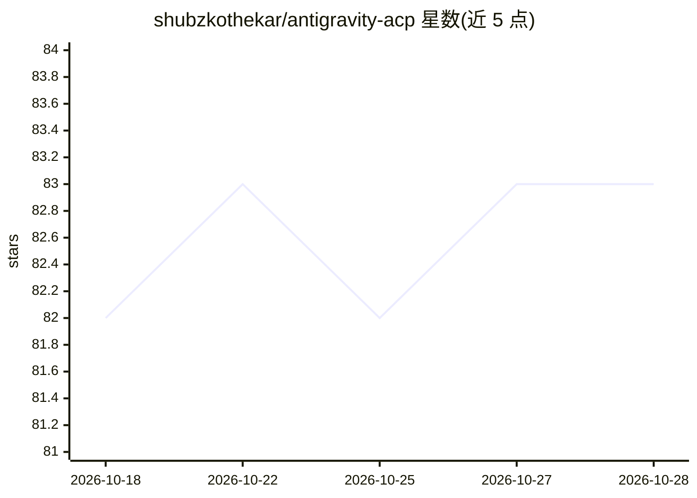

# shubzkothekar/antigravity-acp

⭐ 83 · TypeScript · MIT · 推送 2026-09-27 · [GitHub](https://github.com/shubzkothekar/antigravity-acp) · 个人维护

**让 ACP 兼容编辑器驱动 Google Antigravity `agy` CLI 的协议服务器**

基于 Bun 实现的 Agent Client Protocol (ACP) 服务器：以子进程方式启动官方 `agy` 二进制并通过 stdio 通信，向 ACP 兼容编辑器提供实时进度流式输出与按需回放会话历史（读取 agy 的 SQLite 对话库，含工具调用、任务/权限/错误装饰）。支持 initialize、session/new、session/load、session/resume 等 ACP 表面，提供模型与模式选择；启动时按优先级定位 `agy`，缺失时自动从 GitHub 下载并校验 SHA-256。提供源码运行（需 Bun）与六平台预编译单文件可执行两种方式。README 明确标注使用该项目驱动个人 Antigravity 账号存在 Google 服务条款风险，可能导致账号被停用。

## 筛选速览

| 维度 | 判定 | 备注 |
|---|---|---|
| AI 角色 | `ai-ecosystem` | LLM/agent 周边工具 |
| 许可风险 | `permissive` | MIT |
| 部署形态 | `desktop` | 安装包/桌面程序 |
| 模型依赖 | — | README 未给出锁定关系 |
| 硬件要求 | — | 无带数字的原话,不猜 |
| 安装摩擦 | `low` | 无编译、无系统依赖或容器化 |
| 成熟度 | — | 结构信号不足 |

## 能力要点

- 以 stdio 子进程方式驱动官方 agy 二进制，不处理任何认证凭据
- 实时流式输出与基于 SQLite 对话库的历史回放共用同一 Translator 引擎
- 按 (mtime, size) 校验的增量回放缓存与复用的 bun:sqlite 句柄
- 提供 macOS/Linux/Windows 六平台预编译单文件可执行，agy 缺失时自动下载并校验 SHA-256

## 适用场景

- 用 Zed 等 ACP 兼容编辑器直接操作 Antigravity 的 agy 编码代理
- 在编辑器内回放历史会话并切换模型与模式
- 为 agy 提供协议接入层而无需自行处理 OAuth 凭据

## 场景标签

`编码 Agent` · 领域:编码与开发

## 证据(README 行号)

> L3: An Agent Client Protocol (ACP) server for
> L5: ACP-compatible editor drive `agy`: it spawns the CLI, streams its progress live,

## 星数曲线

2026-10-18 82 → 2026-10-28 83（+1）

---
*卡片 v1 · prompt 1.4 · 生成 2026-10-24 · 置信度 high · 依据 README sha `d961d6f77cb4` · [字段定义](../../DATASET.md)*
