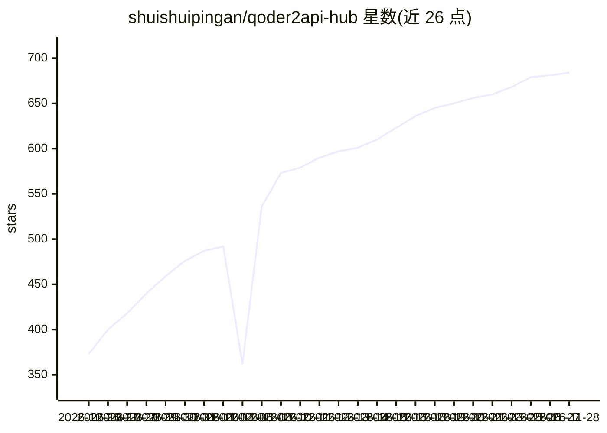

# shuishuipingan/qoder2api-hub

⭐ 684 · Python · MIT · 推送 2026-11-26 · [GitHub](https://github.com/shuishuipingan/qoder2api-hub) · [官网](https://qoder2api-hub-eybpg15659n.qoder.zone) · 个人维护 · 中文 README

**给开发者把 Qoder 双区账号封装为 OpenAI/Anthropic 兼容接口的网关**

自托管的多账号反代网关，将 Qoder 国内版与国际版封装为 OpenAI Chat Completions、Responses API、Anthropic Messages 三种协议接口。账号池按模型自动选区，支持账号轮询、会话亲和、故障冷却换号；通过 OAuth 设备授权或 PAT 导入添加账号，自动签到领取 Credits 并刷新 Token。出站身份对齐官方客户端并可选并发闸门与请求节奏控制；提供 Web 看板管理账号、用量、请求流水与 API Key。仅依赖 Python 3.9+ 标准库，提供 amd64/arm64 Docker 镜像。

## 筛选速览

| 维度 | 判定 | 备注 |
|---|---|---|
| AI 角色 | `ai-ecosystem` | LLM/agent 周边工具 |
| 许可风险 | `permissive` | MIT |
| 部署形态 | `self-host` | docker 或自建部署 |
| 模型依赖 | — | README 未给出锁定关系 |
| 硬件要求 | — | 无带数字的原话,不猜 |
| 安装摩擦 | `low` | 无编译、无系统依赖或容器化 |
| 成熟度 | — | 结构信号不足 |

## 能力要点

- 三种协议：OpenAI Chat Completions、Responses API（Codex）、Anthropic Messages（Claude Code）
- 双区多账号池，按模型自动选区与轮询、故障冷却换号
- OAuth 设备授权免客户端登录，自动签到与 Token 保活
- Web 看板管理账号/用量/请求流水，支持 31 个客户端的一键配置

## 适用场景

- 用 OpenAI 兼容客户端（Cherry Studio、Chatbox 等）接入 Qoder 账号
- 在 Codex CLI 或 Claude Code 中使用 Qoder 模型
- 管理多个 Qoder 账号的额度与凭证生命周期

## 场景标签

`模型网关` · 领域:Agent 开发

## 证据(README 行号)

> L3:  把 Qoder 国内版（qoder.com.cn）与国际版（qoder.com）封装成 OpenAI / Anthropic 兼容接口的多账号网关
> L15: - **三种协议**：OpenAI Chat Completions、Responses API（Codex）、Anthropic Messages（Claude Code）
> L21: - **Web 看板**：账号、用量与性能指标、请求流水、限额护栏、智能体一键配置

## 星数曲线

2026-10-26 373 → 2026-11-28 684（+311）

---
*卡片 v1 · prompt 1.4 · 生成 2026-11-27 · 置信度 high · 依据 README sha `15350c352428` · [字段定义](../../DATASET.md)*
