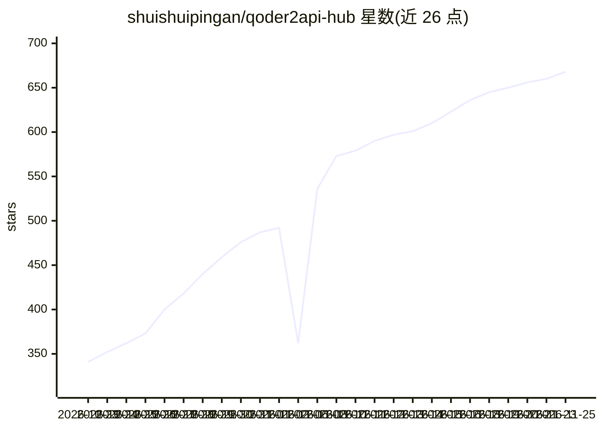

# shuishuipingan/qoder2api-hub

⭐ 668 · Python · MIT · 推送 2026-11-23 · [GitHub](https://github.com/shuishuipingan/qoder2api-hub) · [官网](https://qoder2api-hub-eybpg15659n.qoder.zone) · 个人维护 · 中文 README

**把 Qoder 国内/国际版封装成 OpenAI 兼容接口的多账号网关**

自托管的 Qoder 双区（qoder.com.cn / qoder.com）多账号反向代理网关：将 Qoder 封装为 OpenAI Chat Completions、Responses（Codex）与 Anthropic Messages（Claude Code）三种协议接口。机制包括国内/国际独立账号池与按模型自动选区、账号轮询与会话亲和、OAuth 设备授权与 PAT 导入、每日签到保活、COSY 签名与设备指纹对齐官方客户端、Web 看板展示账号与用量指标。仅用 Python 标准库实现，提供启动脚本与 Docker 镜像；声明为非官方工具，仅供个人在私有环境使用自己合法授权的账号。

## 筛选速览

| 维度 | 判定 | 备注 |
|---|---|---|
| AI 角色 | `ai-ecosystem` | LLM/agent 周边工具 |
| 许可风险 | `permissive` | MIT |
| 部署形态 | `self-host` | docker 或自建部署 |
| 模型依赖 | locked-api |  |
| 硬件要求 | — | 无带数字的原话,不猜 |
| 安装摩擦 | `low` | 无编译、无系统依赖或容器化 |
| 成熟度 | — | 结构信号不足 |

## 能力要点

- 三种协议接入：OpenAI Chat Completions、Responses（Codex）、Anthropic Messages（Claude Code）
- 国内/国际双区账号池，账号轮询、会话亲和、故障冷却换号
- OAuth 设备授权免客户端登录，自动签到与 Token 刷新
- 零依赖纯 Python 标准库实现，附带 Web 监控看板与 Docker 镜像

## 适用场景

- 在 Cherry Studio、Chatbox 等标准 OpenAI 兼容客户端中使用 Qoder 账号
- 让 Claude Code 或 Codex CLI 通过本地网关接入 Qoder 模型
- 集中管理多个 Qoder 账号的额度、签到与用量监控

## 场景标签

`模型网关` · 领域:Agent 开发

## 证据(README 行号)

> L3:  把 Qoder 国内版（qoder.com.cn）与国际版（qoder.com）封装成 OpenAI / Anthropic 兼容接口的多账号网关
> L15: - **三种协议**：OpenAI Chat Completions、Responses API（Codex）、Anthropic Messages（Claude Code）

## 星数曲线

2026-10-23 341 → 2026-11-25 668（+327）

---
*卡片 v1 · prompt 1.4 · 生成 2026-11-24 · 置信度 high · 依据 README sha `6aaa398766ee` · [字段定义](../../DATASET.md)*
