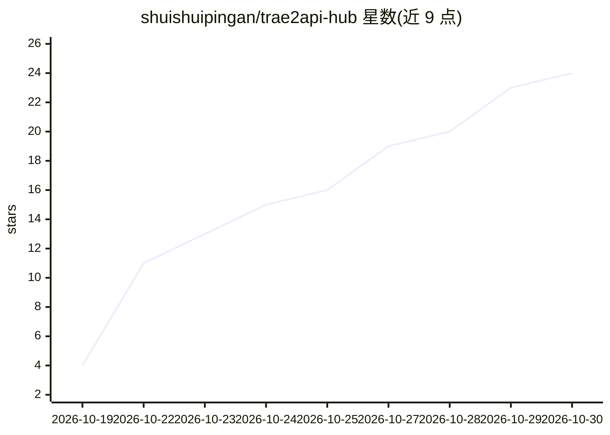

# shuishuipingan/trae2api-hub

⭐ 24 · Python · MIT · 推送 2026-10-23 · [GitHub](https://github.com/shuishuipingan/trae2api-hub) · [官网](https://trae2api-hub-eybpg15659n.qoder.zone/) · 个人维护 · 中文 README

**Trae 国际/国内双区多账号 OpenAI 兼容网关**

把 Trae 国际版与国内版的原生模型服务封装为 OpenAI 兼容 API，提供 Chat Completions、Responses（Codex / Claude Code）与 Anthropic Messages 三种协议，支持双区账号池、按模型归属自动换区、模型目录、流式推理与工具调用。附带 Web 监控看板，含额度预警与自动降级、API Key 模型白名单与日配额、配置备份/恢复与一键更新。单进程标准库实现，推理链路零 pip 依赖，提供本机脚本、Docker Compose 与 GHCR 镜像三种部署方式。SOLO Agent 通道需有效 accessToken 与匹配的 device_id/machine_id，非无账号方案。

## 筛选速览

| 维度 | 判定 | 备注 |
|---|---|---|
| AI 角色 | `ai-ecosystem` | LLM/agent 周边工具 |
| 许可风险 | `permissive` | MIT |
| 部署形态 | `self-host` | docker 或自建部署 |
| 模型依赖 | — | README 未给出锁定关系 |
| 硬件要求 | — | 无带数字的原话,不猜 |
| 安装摩擦 | `low` | 无编译、无系统依赖或容器化 |
| 成熟度 | — | 结构信号不足 |

## 能力要点

- 双区账号池：多账号权重、冷却、轮换、会话亲和与自动换区路由
- 三种 API 协议：OpenAI Chat Completions / Responses / Anthropic Messages
- API Key 治理：模型通配白名单、日配额（请求数/Token）、按 Key 用量透视
- 额度预警与自动降级，响应头 X-Trae-Degraded 标记

## 适用场景

- 把 Trae 账号封装成 OpenAI 兼容接口给 Cursor、Cline、Claude Code 等客户端使用
- 多账号池化管理 Trae 额度并自动降级到备用模型
- 团队内按 API Key 分配配额与限制可用模型

## 场景标签

`模型网关` · 领域:Agent 开发

## 证据(README 行号)

> L11: **Trae2API-Hub** 把 Trae **国际版**与**国内版**的原生模型服务封装成标准 **OpenAI 兼容 API**，支持 Chat Completions、Responses（Codex / Claude 
> L64: - OpenAI **Chat Completions**：`/v1/chat/completions`
> L68: - 兼容 Cursor、Continue、Cline、Codex、Claude Code、OpenAI SDK 等

## 星数曲线

2026-10-19 4 → 2026-10-30 24（+20）

---
*卡片 v1 · prompt 1.4 · 生成 2026-10-28 · 置信度 high · 依据 README sha `602dbb03bf95` · [字段定义](../../DATASET.md)*
