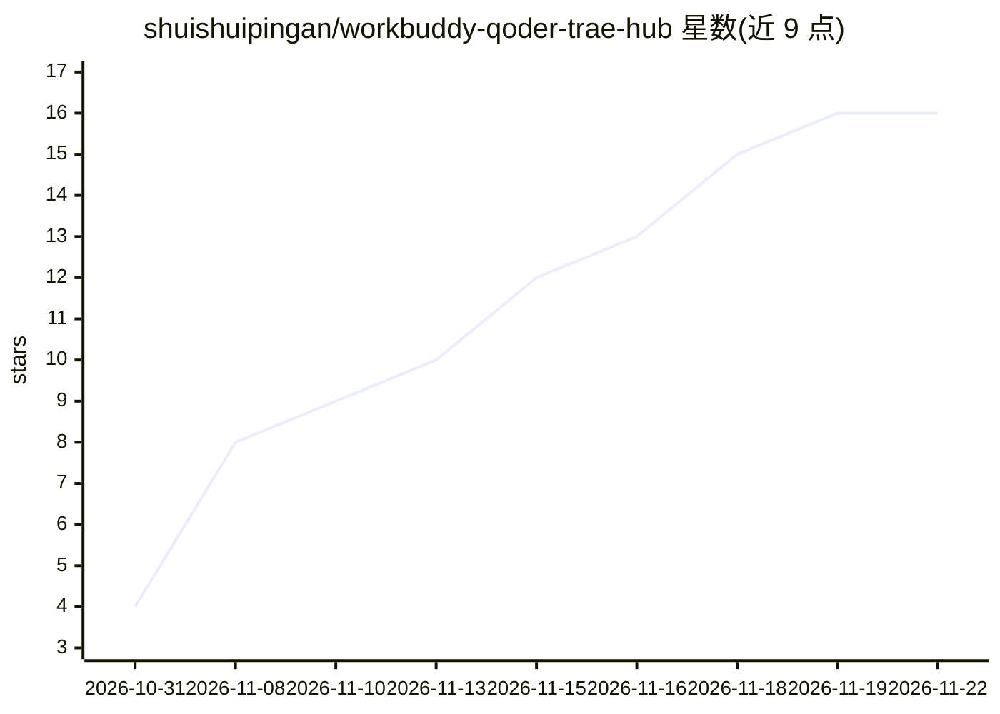

# shuishuipingan/workbuddy-qoder-trae-hub

⭐ 16 · Python · NOASSERTION · 推送 2026-11-21 · [GitHub](https://github.com/shuishuipingan/workbuddy-qoder-trae-hub) · [官网](https://wqt-hub-eybpg15659n.qoder.zone) · 个人维护 · 中文 README

**把 Qoder 封装成 OpenAI/Anthropic 兼容接口的多账号网关**

用 Python 标准库（零第三方依赖）实现的自托管 LLM 网关：将 Qoder 国内版与国际版封装为 OpenAI Chat Completions、Responses API 与 Anthropic Messages 三种兼容协议，单端口 8790 对外。核心机制包括国内/国际双区账号池与按模型自动选区、账号轮询与会话亲和、故障冷却换号、OAuth 设备授权或导入官方客户端凭证、每日 Credits 自动签到与 Token 定时刷新、出站身份对齐官方客户端的风控对策。内置 Web 看板展示账号、用量、请求流水，支持 31 个客户端的接入指引（13 类可一键配置）。提供 amd64/arm64 Docker 镜像。项目为非官方实现，仅供个人研究使用。

## 筛选速览

| 维度 | 判定 | 备注 |
|---|---|---|
| AI 角色 | `ai-ecosystem` | LLM/agent 周边工具 |
| 许可风险 | `none` | NOASSERTION |
| 部署形态 | `self-host` | docker 或自建部署 |
| 模型依赖 | — | README 未给出锁定关系 |
| 硬件要求 | — | 无带数字的原话,不猜 |
| 安装摩擦 | `low` | 无编译、无系统依赖或容器化 |
| 成熟度 | — | 结构信号不足 |

## 能力要点

- OpenAI Chat / Responses / Anthropic Messages 三协议兼容，单端口对外
- 双区多账号池：轮询、会话亲和、故障冷却换号、按模型自动选区
- 零第三方依赖（纯 Python 标准库实现 COSY 签名与 AES/RSA）
- 内置 Web 看板与 31 个客户端接入指引（13 类一键配置）

## 适用场景

- 把 Qoder 账号接入 Claude Code、Codex CLI 等 AI 编程客户端
- 多账号额度轮转使用，自动签到领取每日 Credits
- 在一个 OpenAI 兼容端点后统一管理国内版与国际版账号

## 场景标签

`模型网关` · 领域:Agent 开发

## 证据(README 行号)

> L15: - **三种协议**：OpenAI Chat Completions、Responses API（Codex）、Anthropic Messages（Claude Code）
> L3:  把 Qoder 国内版（qoder.com.cn）与国际版（qoder.com）封装成 OpenAI / Anthropic 兼容接口的多账号网关

## 星数曲线

2026-10-31 4 → 2026-11-22 16（+12）

---
*卡片 v1 · prompt 1.4 · 生成 2026-11-18 · 置信度 high · 依据 README sha `d567a6c86087` · [字段定义](../../DATASET.md)*
