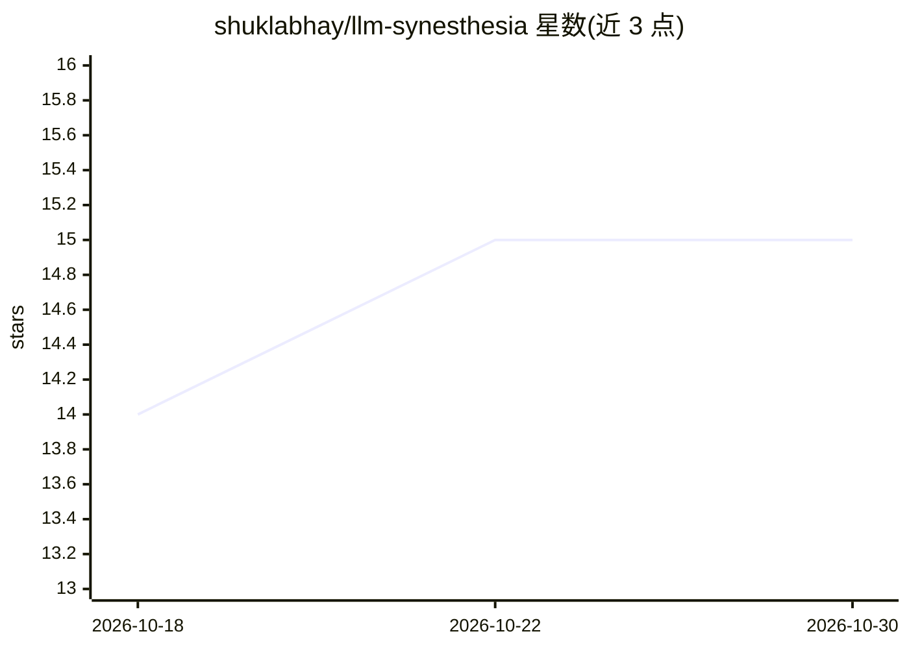

# shuklabhay/llm-synesthesia

⭐ 15 · Python · 推送 2026-04-05 · [GitHub](https://github.com/shuklabhay/llm-synesthesia) · 个人维护

**LLM 情绪状态提取与 WebGL 可视化管线**

从 Hermes-4.3-36B 生成过程读取 Layer-48 隐层状态，经 EMA 平滑后由情绪 MLP 探针预测 9 类情绪分布，并将概率映射为 2D 情绪空间坐标；logit 与隐层统计量转化为旋转、分支、发光等渲染参数，注入 WebGL2 流场渲染。训练与推理部署在 Modal 平台，可选接入 Hermes Agent 走完整本地流程。要求 Python 3.12+、uv、Modal 账号与支持 WebGL2 的浏览器，Hermes Agent 为可选组件。

## 筛选速览

| 维度 | 判定 | 备注 |
|---|---|---|
| AI 角色 | `ai-native` | 本体是模型或模型工具 |
| 许可风险 | `none` | — |
| 部署形态 | `None` |  |
| 模型依赖 | — | README 未给出锁定关系 |
| 硬件要求 | — | 无带数字的原话,不猜 |
| 安装摩擦 | `low` | 无编译、无系统依赖或容器化 |
| 成熟度 | — | 结构信号不足 |

## 能力要点

- Layer-48 隐层状态经 EMA 平滑后由 MLP 探针预测 9 类情绪
- 情绪概率映射为 2D 情绪空间坐标与渲染控制参数
- 推理与训练通过 Modal 部署，提供 hermes / hermes-bridge / random 三种运行模式
- 可选配置 Hermes Agent provider 对接 synesthesia 端点

## 适用场景

- 实时观察 LLM 生成过程中的情绪状态可视化
- 通过 Hermes Agent 对话时同步查看模型情绪流场渲染
- 仅运行 bridge+renderer 或 mock 模式做本地调试

## 场景标签

`科研工具` · 领域:学习与行业

## 证据(README 行号)

> L10: - Layer-48 hidden states are EMA-smoothed and passed through an emotion MLP probe
> L11: - The probe predicts distribution of 9 emotions:

## 星数曲线

2026-10-18 14 → 2026-10-30 15（+1）

---
*卡片 v1 · prompt 1.4 · 生成 2026-10-30 · 置信度 high · 依据 README sha `e27e0b4ea836` · [字段定义](../../DATASET.md)*
