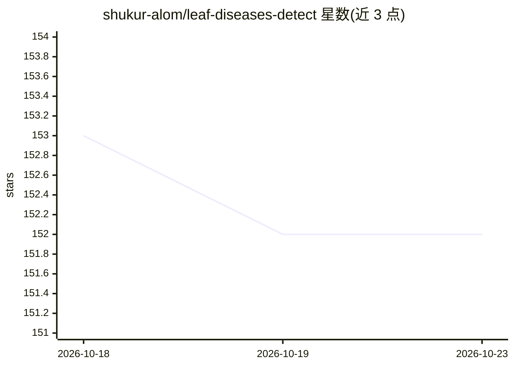

# shukur-alom/leaf-diseases-detect

⭐ 152 · Python · MIT · 推送 2026-03-01 · [GitHub](https://github.com/shukur-alom/leaf-diseases-detect) · [官网](https://leaf-diseases-detect5.streamlit.app) · 个人维护

**通过 Llama Vision 识别叶片病害并给出严重度与治疗建议**

叶片病害检测系统，采用 FastAPI 后端加 Streamlit 前端双接口架构，核心检测引擎调用 Groq API 上的 Meta Llama Vision 模型，对上传叶片图片输出病害名称与类别、严重程度、置信度、症状、可能诱因及治疗建议，支持 JPEG/PNG/WebP/BMP/TIFF，单图限 10MB，需要 Groq API Key。提供 Vercel/Streamlit Cloud/Railway/Docker/Heroku 等部署说明，另含测试脚本与示例图片。

## 筛选速览

| 维度 | 判定 | 备注 |
|---|---|---|
| AI 角色 | `ai-native` | 本体是模型或模型工具 |
| 许可风险 | `permissive` | MIT |
| 部署形态 | `self-host` | docker 或自建部署 |
| 模型依赖 | locked-api |  |
| 硬件要求 | — | 无带数字的原话,不猜 |
| 安装摩擦 | `low` | 无编译、无系统依赖或容器化 |
| 成熟度 | — | 结构信号不足 |

## 能力要点

- 识别 500+ 种植物病害（真菌/细菌/病毒/虫害/营养缺乏）并输出严重度分级
- 返回结构化 JSON：病害名、类别、置信度 0-100%、症状、诱因、治疗建议
- FastAPI 与 Streamlit 双接口，支持 REST API 与网页交互
- 默认模型 meta-llama/llama-4-scout-17b-16e-instruct，可经环境变量切换模型与参数

## 适用场景

- 上传叶片照片获取病害识别与治疗建议
- 农业或园艺场景批量接入病害检测 API
- 教学或演示多模态 LLM 在植物健康分析中的应用

## 场景标签

 · 领域:农业/植物健康

## 证据(README 行号)

> L9: An enterprise-grade AI-powered leaf disease detection system featuring a dual-interface architecture: a FastAPI back
> L20: - **🔍 Advanced Disease Detection**: Identifies 500+ plant diseases across multiple categories (fungal, bacterial, v
> L52: The heart of the system, featuring the **LeafDiseaseDetector Class** which provides advanced AI-powered leaf diseas

## 星数曲线

2026-10-18 153 → 2026-10-23 152（-1）

---
*卡片 v1 · prompt 1.4 · 生成 2026-10-22 · 置信度 mid · 依据 README sha `7ab350a3ce63` · [字段定义](../../DATASET.md)*
