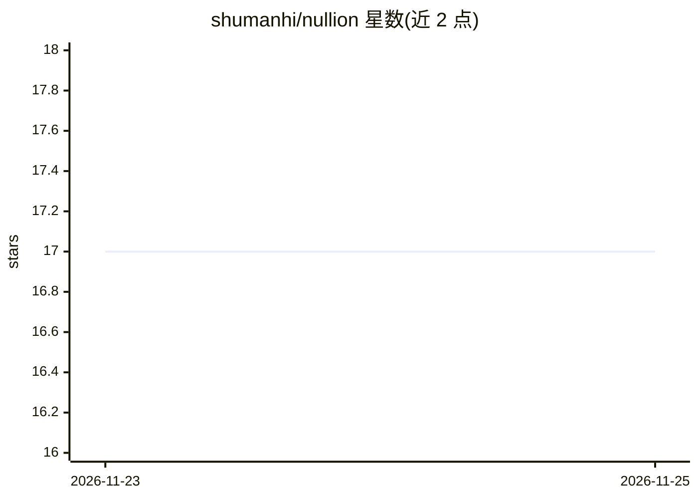

# shumanhi/nullion

⭐ 17 · Python · NOASSERTION · 推送 2026-11-22 · [GitHub](https://github.com/shumanhi/nullion) · [官网](https://www.nullion.ai) · 个人维护

**本地运行的个人 AI 助手：浏览器研究、文件与定时任务**

本地运行的开源个人 AI 助手，将用户自选的模型接入浏览器、文件与启用的工具，通过本地 Web 控制台或 Telegram/Slack/Discord 交互，产出回答、可下载文件或定时/监控任务的更新。支持提醒、周期任务与限时页面监控，工具权限、文件范围与审批规则由用户配置，历史与记忆存于本机并支持本地加密。运行时基于 LangGraph 与 LangChain 兼容适配器，采用 Apache 2.0 许可，模型与连接服务的费用由用户另行承担。

## 筛选速览

| 维度 | 判定 | 备注 |
|---|---|---|
| AI 角色 | `ai-native` | 本体是模型或模型工具 |
| 许可风险 | `none` | NOASSERTION |
| 部署形态 | `None` |  |
| 模型依赖 | — | README 未给出锁定关系 |
| 硬件要求 | — | 无带数字的原话,不猜 |
| 安装摩擦 | `low` | 无编译、无系统依赖或容器化 |
| 成熟度 | — | 结构信号不足 |

## 能力要点

- 接入自选模型，驱动浏览器研究与文件任务
- 定时任务、周期简报与限时页面监控
- 多端入口：本地 Web 控制台、Telegram、Slack、Discord
- 工具权限与审批模式可配置，支持本地加密存储

## 适用场景

- 让助手在浏览器中比较选项并生成带来源的报告
- 把附件笔记整理成项目文档
- 每天定时接收指定主题的研究简报
- 限时监控某网页并在条件出现时通知

## 场景标签

`AI 助手` `浏览器自动化` · 领域:效率与自动化

## 证据(README 行号)

> L13: Nullion connects the model you choose to your browser, files, and enabled tools.
> L184: The runtime uses LangGraph, LangChain-compatible adapters, and Deep Agents.

## 星数曲线

2026-11-23 17 → 2026-11-25 17（+0）

---
*卡片 v1 · prompt 1.4 · 生成 2026-11-23 · 置信度 high · 依据 README sha `0c99edbd0bf2` · [字段定义](../../DATASET.md)*
