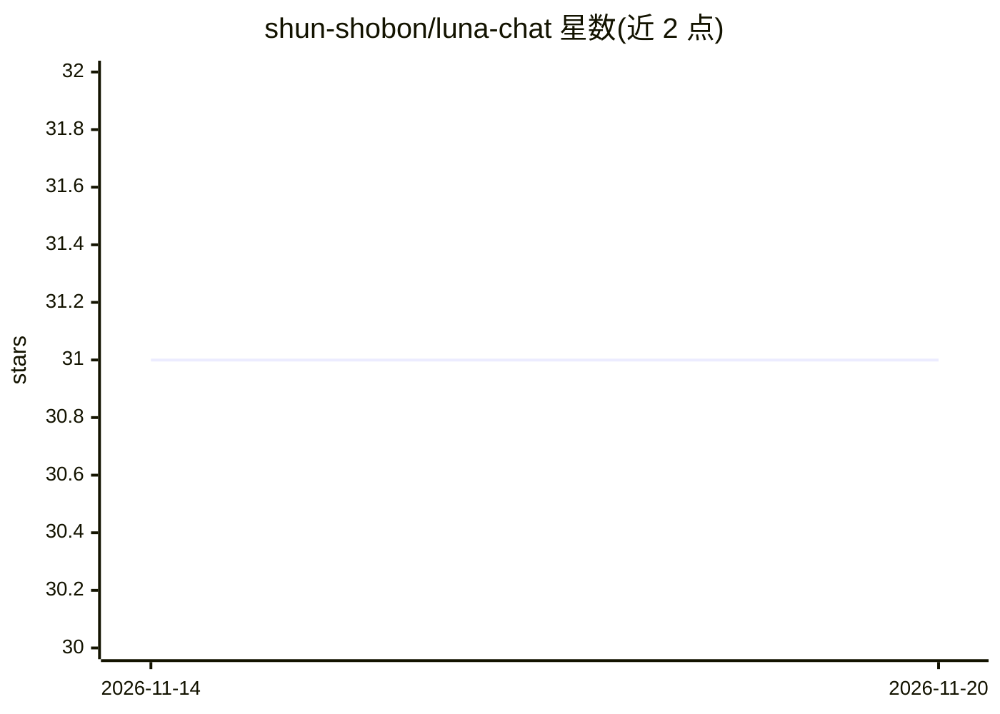

# shun-shobon/luna-chat

⭐ 31 · TypeScript · MIT · 推送 2026-11-19 · [GitHub](https://github.com/shun-shobon/luna-chat) · 个人维护 · 中文 README

**常驻 Discord 的自律型个人 AI 代理，支持对话、记忆与定时执行**

TypeScript 实现的个人用 AI 代理，常驻 Discord 进行会话、执行 shell/文件/Web 搜索等工具、在语音频道用 sherpa-onnx 本地语音识别交谈，并可由 AivisSpeech 等 VOICEVOX 兼容 TTS 读出回复。模型来自 ChatGPT 订阅（设备码登录），代理运行时使用 pi。具备日次/长期记忆整理、随机心跳推进 AGENDA、cron.toml 定时任务、话题触发意图、Home Assistant 设备控制、本地 HTTP API 与只读仪表盘；Linux 主机上可部署带 Chrome 的专用桌面供其操作网页。安全限制：输入者不与宿主权限隔离，README 明确警告不可部署于不可信第三方可输入的环境。

## 筛选速览

| 维度 | 判定 | 备注 |
|---|---|---|
| AI 角色 | `ai-native` | 本体是模型或模型工具 |
| 许可风险 | `permissive` | MIT |
| 部署形态 | `self-host` | docker 或自建部署 |
| 模型依赖 | — | README 未给出锁定关系 |
| 硬件要求 | — | 无带数字的原话,不猜 |
| 安装摩擦 | `low` | 无编译、无系统依赖或容器化 |
| 成熟度 | — | 结构信号不足 |

## 能力要点

- 会话结束自动摘要入记忆，每日定时整理长期记忆 MEMORY.md 与工作区
- 心跳机制随机唤醒，从 AGENDA.md 与检查清单自主推进任务
- 语音频道内本地语音识别（sherpa-onnx）对话与 VOICEVOX 兼容 TTS 朗读
- Home Assistant 实体监控与操作，可作为 Assist 语音会话代理

## 适用场景

- 在 Discord 里养一个常驻的个人 AI 助手日常对话
- 让代理按 cron 或设备状态变化自动执行任务
- 接入 Home Assistant 做家居设备的状态监控与语音交互

## 场景标签

`Agent 记忆` `AI 助手` `工作流自动化` · 领域:Agent 开发

## 证据(README 行号)

> L3: Lunaは、Discordに常駐して会話し、自分でスケジュールを回して動く個人用のAIエージェントです。ChatGPTのサブスクリプションでモデルを使い、エージェントの実行には pi を使います。1つの配置につき、1つのDiscor
> L21: - **会話**：常設チャンネル、メンションで始まる一時セッション、DMで会話します。同じ会話の投稿をまとめて受け取り、返信・リアクション・ファイル添付で応えます。

## 星数曲线

2026-11-14 31 → 2026-11-20 31（+0）

---
*卡片 v1 · prompt 1.4 · 生成 2026-11-18 · 置信度 high · 依据 README sha `cd12315b882c` · [字段定义](../../DATASET.md)*
