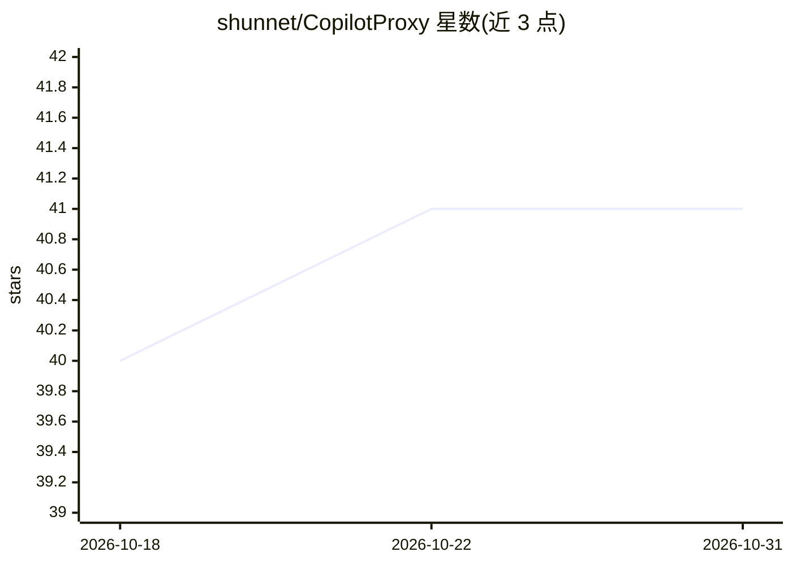

# shunnet/CopilotProxy

⭐ 41 · JavaScript · MIT · 推送 2026-10-20 · [GitHub](https://github.com/shunnet/CopilotProxy) · [官网](https://snet.cn) · 组织维护 · 中文 README

**Windows 桌面代理：把 Copilot 接到 DeepSeek/小米 MiMo**

由 Snet.cn 维护的 Windows WPF 管理工具加本地代理服务：在 GitHub Copilot Chat/Agent 与 DeepSeek、小米 MiMo 之间转换协议，同时提供 Ollama NDJSON 与 OpenAI Chat Completions 双入口，默认监听 127.0.0.1:11434。模型从供应商官方目录自动发现，不维护固定型号白名单、不设默认模型；支持工具调用、推理回传与视觉输入。限制：仅 Windows，WPF 需 .NET 10 Desktop Runtime，管理接口无公网鉴权，/v1/responses 未实现。

## 筛选速览

| 维度 | 判定 | 备注 |
|---|---|---|
| AI 角色 | `ai-ecosystem` | LLM/agent 周边工具 |
| 许可风险 | `permissive` | MIT |
| 部署形态 | `desktop` | 安装包/桌面程序 |
| 模型依赖 | local-ok | 支持本地模型 |
| 硬件要求 | — | 无带数字的原话,不猜 |
| 安装摩擦 | `high` | 编译与系统依赖俱全 |
| 成熟度 | — | 结构信号不足 |

## 能力要点

- Ollama NDJSON 与 OpenAI JSON/SSE 双协议入口
- 模型从 DeepSeek / MiMo 官方目录自动发现，无固定白名单
- WPF 桌面管理：配置、构建、启停、实时日志
- 有界并发队列、明确重试与背压清理，未实现接口返回 501

## 适用场景

- 在 Visual Studio / VS Code 的 Copilot 中使用 DeepSeek 或小米 MiMo 模型
- 通过 Ollama 兼容端点把 IDE 连接到云端模型供应商
- 在桌面界面管理代理配置、构建与日志

## 场景标签

`模型网关` · 领域:Agent 开发

## 证据(README 行号)

> L20: CopilotProxy 是一个 **Windows WPF 管理工具与本地 Ollama / OpenAI Chat Completions 兼容代理**，在 GitHub Copilot Chat / Agent 与 Deep
> L28:  🔄 双协议入口 Ollama NDJSON 与 OpenAI JSON/SSE 共用模型、消息、队列和上游传输管线
> L72: 使用 **18.10+ 的新 Agent (Preview)**。打开 Chat → 模型选择器 → **Add a model / Manage Models** → 连接 **Ollama 自定义端点**，服务地址为 `htt

## 星数曲线

2026-10-18 40 → 2026-10-31 41（+1）

---
*卡片 v1 · prompt 1.4 · 生成 2026-10-25 · 置信度 high · 依据 README sha `f01648afb18d` · [字段定义](../../DATASET.md)*
