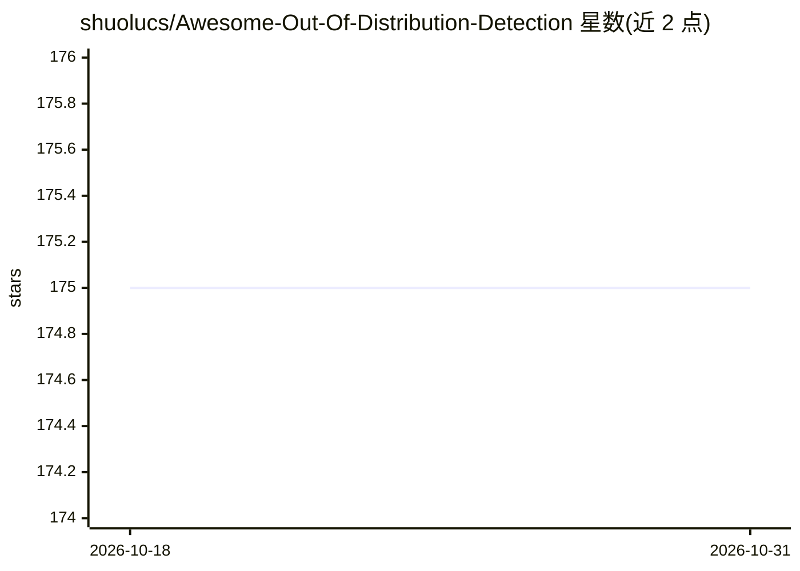

# shuolucs/Awesome-Out-Of-Distribution-Detection

⭐ 175 · 推送 2026-01-02 · [GitHub](https://github.com/shuolucs/Awesome-Out-Of-Distribution-Detection) · [官网](https://arxiv.org/abs/2409.11884) · 组织维护

**OOD 检测论文策展清单：配套 ACM CSUR 2025 综述**

配合论文《Out-of-Distribution Detection: A Task-Oriented Survey of Recent Advances》（ACM Computing Surveys 2025）整理的论文清单仓库：按训练驱动（仅 ID 数据/ID+OOD 数据）与训练无关（事后方法）两大类组织，细分为重构、概率、Logits、OOD 合成、原型、长尾、边界正则、离群挖掘、输出、距离等子类，每条目含论文标题、作者、发表会议与 PDF/代码链接。面向 OOD 检测方向的研究人员检索文献使用。

## 筛选速览

| 维度 | 判定 | 备注 |
|---|---|---|
| AI 角色 | `ai-knowledge` | 知识聚合/清单类 |
| 许可风险 | `none` | — |
| 部署形态 | `None` |  |
| 模型依赖 | — | README 未给出锁定关系 |
| 硬件要求 | — | 无带数字的原话,不猜 |
| 安装摩擦 | `low` | 无编译、无系统依赖或容器化 |
| 成熟度 | — | 结构信号不足 |

## 能力要点

- 按综述任务导向框架组织的方法分类体系
- 覆盖 NeurIPS/ICML/ICLR/CVPR 等会议论文条目
- 条目附 PDF 与代码链接（部分）

## 适用场景

- 查找 OOD 检测各技术路线的代表性论文
- 按方法类别（重构/概率/事后等）梳理研究脉络
- 定位开源代码以复现方法

## 场景标签

`精选清单` `科研工具` · 领域:学习与行业

## 证据(README 行号)

> L3: > A curated list of awesome out-of-distribution detection resources.
> L5: > The organization of papers refers to our survey **"Out-of-Distribution Detection: A Task-Oriented Survey of Recent

## 星数曲线

2026-10-18 175 → 2026-10-31 175（+0）

---
*卡片 v1 · prompt 1.4 · 生成 2026-10-23 · 置信度 high · 依据 README sha `634c759b0d12` · [字段定义](../../DATASET.md)*
