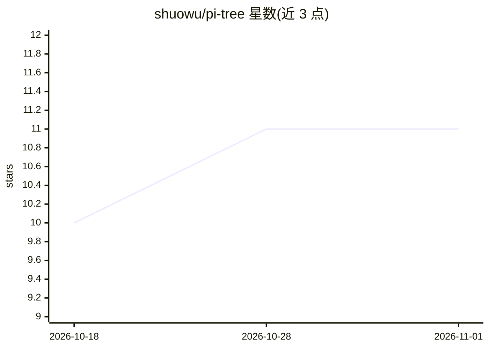

# shuowu/pi-tree

⭐ 11 · TypeScript · AGPL-3.0 · 推送 2026-10-19 · [GitHub](https://github.com/shuowu/pi-tree) · [官网](https://shuowu.github.io/pi-tree/) · 个人维护

**本地优先的 AI 阅读伴侣：树状对话读图书/论文/新闻/视频**

面向个人阅读者的本地优先开源应用：将 EPUB/MOBI/PDF 书籍、arXiv 论文、RSS 新闻源和 YouTube 视频纳入统一图书馆，通过树状分支对话与 AI 共读。核心机制包括：每个分支只发送自身路径上下文以控制成本与准确性、跨源概念知识图谱与 memo、基于阅读历史的推荐、按源类型划分的插件架构（SKILL.md/YAML/完整插件三级扩展）。BYOK 模式，支持 DeepSeek/Gemini/Claude 等 API 或 Ollama 本地模型完全离线。提供 Docker、源码与实验性桌面应用三种安装方式；AGPL-3.0 许可。

## 筛选速览

| 维度 | 判定 | 备注 |
|---|---|---|
| AI 角色 | `ai-native` | 本体是模型或模型工具 |
| 许可风险 | `viral` | AGPL-3.0 |
| 部署形态 | `desktop` | 安装包/桌面程序 |
| 模型依赖 | local-ok | 支持本地模型 |
| 硬件要求 | — | 无带数字的原话,不猜 |
| 安装摩擦 | `low` | 无编译、无系统依赖或容器化 |
| 成熟度 | `idea` | |

## 能力要点

- 四种源类型（书籍/论文/新闻/YouTube）由专用插件处理
- 树状对话结构，分支仅发送自身路径上下文
- 跨源概念知识图谱与 memo 系统（/memo、/recall）
- BYOK 多供应商，可经 Ollama 完全离线运行

## 适用场景

- 读书时逐章与 AI 讨论并沿概念分支深入探索
- 读 arXiv 论文时针对方法论或相关工作提问
- 扫描 RSS 新闻趋势并与 AI 讨论报道
- 完全离线、不上传数据的私密阅读与笔记

## 场景标签

`文档问答` · 领域:知识与检索

## 证据(README 行号)

> L8: **Read books, research papers, news feeds, and YouTube videos with an AI that reads alongside you — entirely on your
> L10: Pi-tree is a local-first, open-source AI reading companion. Add a source to your library, then explore it through b
> L24: 📚 **Books** — Upload EPUB, MOBI, PDF, or Markdown. The AI guides you chapter by chapter with reading skills, struct

## 星数曲线

2026-10-18 10 → 2026-11-01 11（+1）

---
*卡片 v1 · prompt 1.4 · 生成 2026-11-01 · 置信度 high · 依据 README sha `02ee9abec6a5` · [字段定义](../../DATASET.md)*
