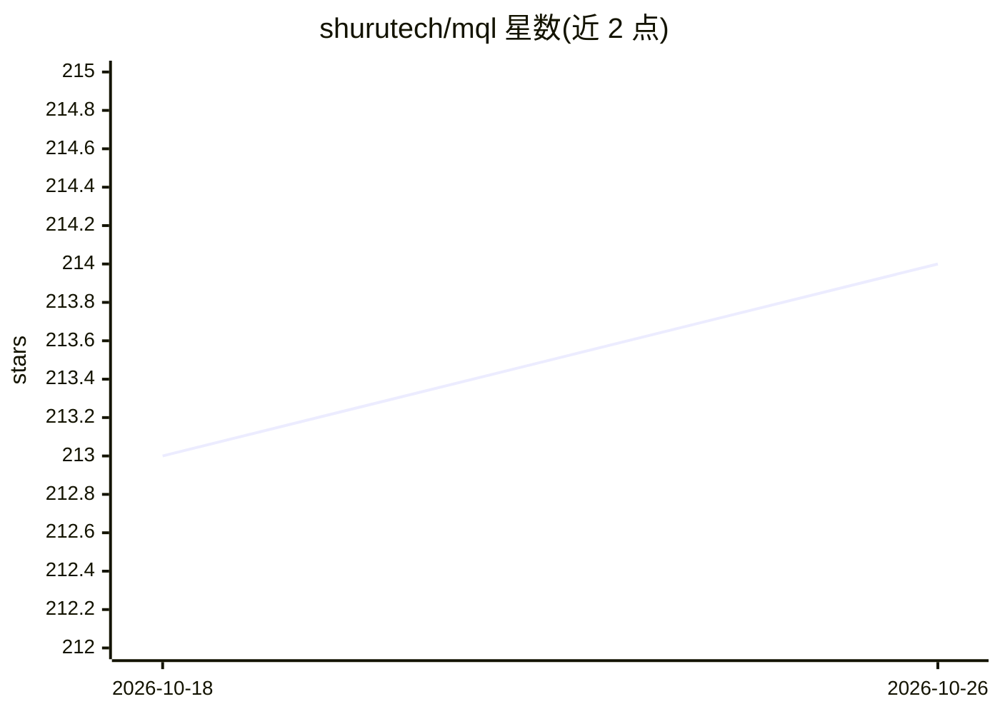

# shurutech/mql

⭐ 214 · Python · MIT · 推送 2026-02-25 · [GitHub](https://github.com/shurutech/mql) · [官网](https://shurutech.com/mql-sql-from-natural-language-with-85-accuracy/) · 组织维护

**自然语言转 SQL 查询工具，面向不会写 SQL 的用户**

MQL (My Query Language) 将自然语言查询转换为可执行的 SQL 语句，目标用户包括不熟悉编程的人员。使用方式为连接 PostgreSQL 数据库或上传 schema，随后以自然语言提问获得 SQL。基于 OpenAI API 与 pgvector 扩展，提供 Web 仪表盘。当前版本仅支持 PostgreSQL；README 报告的测试中 50 条自然语言查询约 85% 成功转换、74% 完全精确执行；查询执行、MySQL 支持等功能列为后续计划。安装途径为 Docker（make install）或本地脚本（setup.sh）。

## 筛选速览

| 维度 | 判定 | 备注 |
|---|---|---|
| AI 角色 | `ai-native` | 本体是模型或模型工具 |
| 许可风险 | `permissive` | MIT |
| 部署形态 | `self-host` | docker 或自建部署 |
| 模型依赖 | — | README 未给出锁定关系 |
| 硬件要求 | — | 无带数字的原话,不猜 |
| 安装摩擦 | `low` | 无编译、无系统依赖或容器化 |
| 成熟度 | — | 结构信号不足 |

## 能力要点

- 自然语言输入生成可执行 SQL，无需编程知识
- 支持连接数据库或上传 schema 两种接入方式
- 提供 Web 仪表盘与默认测试账号
- 自带 50 条查询的准确率测试数据（85% 成功转换）

## 适用场景

- 不写代码直接用自然语言查询 PostgreSQL 数据
- 通过上传 schema 快速获得 SQL 查询语句
- 团队内部部署数据查询界面

## 场景标签

`数据分析` · 领域:效率与自动化

## 证据(README 行号)

> L3: MQL (My Query Language) is a powerful tool to transform natural language queries into executable SQL queries. What's
> L21: - Update server/Dockerfile with your `OPENAI_API_KEY` key:

## 星数曲线

2026-10-18 213 → 2026-10-26 214（+1）

---
*卡片 v1 · prompt 1.4 · 生成 2026-10-22 · 置信度 high · 依据 README sha `3a99791c7aa5` · [字段定义](../../DATASET.md)*
