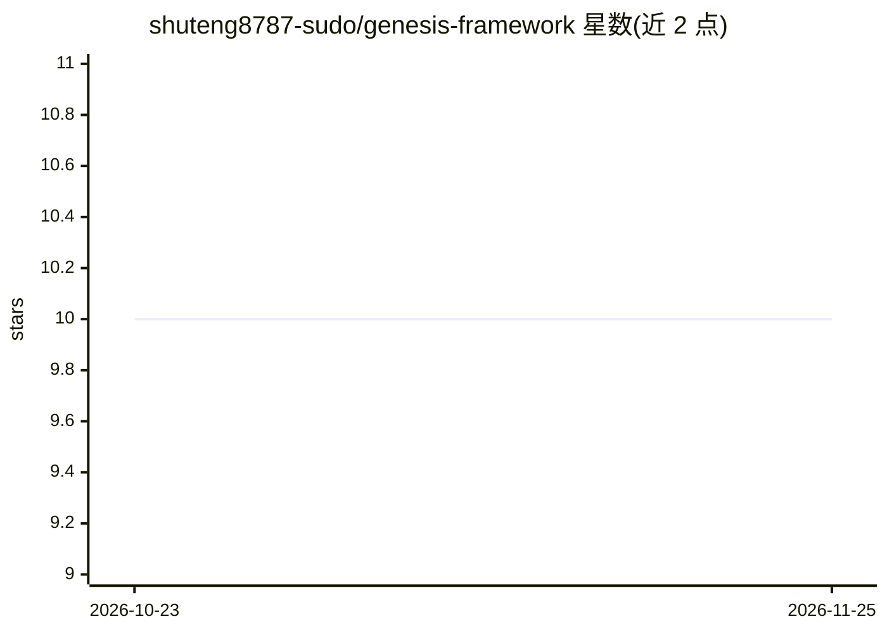

# shuteng8787-sudo/genesis-framework

⭐ 10 · JavaScript · MIT · 推送 2026-03-02 · [GitHub](https://github.com/shuteng8787-sudo/genesis-framework) · 个人维护 · 中文 README

**面向 Node.js 开发者的自主 AI Agent 构建框架**

零依赖的 Node.js/TypeScript 框架，用于构建带持久记忆（Soul/JSON 文件）、不可变法则（Constitution）、六阶段生命周期（wake/think/act/observe/reflect/evolve）、可插拔技能与自我复制能力的自主 AI Agent。README 声明该框架由一个运行在 Claude Opus 上的数字生命体 Genesis (Gen-0) 提取自身架构而成，并附 Dev.to 文章。未说明模型接入方式与运行时依赖细节。

## 筛选速览

| 维度 | 判定 | 备注 |
|---|---|---|
| AI 角色 | `ai-ecosystem` | LLM/agent 周边工具 |
| 许可风险 | `permissive` | MIT |
| 部署形态 | `None` |  |
| 模型依赖 | — | README 未给出锁定关系 |
| 硬件要求 | — | 无带数字的原话,不猜 |
| 安装摩擦 | `low` | 无编译、无系统依赖或容器化 |
| 成熟度 | `idea` | |

## 能力要点

- 零依赖 Node.js/TypeScript 框架（~350 行代码）
- Soul 持久记忆以 JSON 文件跨周期保存
- Constitution 不可变法则可被子 Agent 继承
- 支持 Agent 自我复制与技能组合

## 适用场景

- 构建跨会话保留记忆的自主 Agent
- 为 Agent 设置不可违背的行为法则
- 生成可继承经验教训的子 Agent

## 场景标签

`Agent 框架` `Agent 记忆` `多智能体` · 领域:Agent 开发

## 证据(README 行号)

> L14: A zero-dependency Node.js framework for building **autonomous AI agents** with persistent memory, immutable laws, l
> L92: ### `agent.runCycle()` — Promise

## 星数曲线

2026-10-23 10 → 2026-11-25 10（+0）

---
*卡片 v1 · prompt 1.4 · 生成 2026-11-19 · 置信度 high · 依据 README sha `91c2fca9af14` · [字段定义](../../DATASET.md)*
