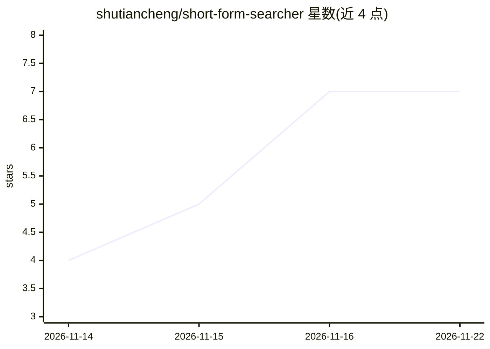

# shutiancheng/short-form-searcher

⭐ 7 · TypeScript · MIT · 推送 2026-11-13 · [GitHub](https://github.com/shutiancheng/short-form-searcher) · [官网](https://www.nouvelhq.com) · 个人维护

**为营销者检索已验证走红的 TikTok/抖音/Meta 短视频**

TypeScript 库与 CLI（`sfs`）：输入产品描述或 URL，经 LLM 规划搜索词、多路查询 competitor 账号、二次 LLM 相关性重排，返回带格式标签、按传播倍数排序的 TikTok/抖音视频，另有 conversions 模式检索 Meta 广告库中持续投放的视频。数据经 Apify（TikTok/Meta 广告库）与 TikHub（抖音）获取，按次预留费用上限。需 Node 20+ 与 Apify key；无模型后端时退化为关键词+流量检索。

## 筛选速览

| 维度 | 判定 | 备注 |
|---|---|---|
| AI 角色 | `ai-native` | 本体是模型或模型工具 |
| 许可风险 | `permissive` | MIT |
| 部署形态 | `library` | 以包/库形式分发 |
| 模型依赖 | — | README 未给出锁定关系 |
| 硬件要求 | — | 无带数字的原话,不猜 |
| 安装摩擦 | `low` | 无编译、无系统依赖或容器化 |
| 成熟度 | — | 结构信号不足 |

## 能力要点

- 双模式：organic 传播视频（views）与持续投放广告（conversions）
- LLM 规划查询 + 相关性重排，配确定性护栏（reach 门槛、语言检查、去 spam/转载）
- 多模型后端（Gemini/Vertex/Claude/OpenAI 兼容）可组合成 fallback 链
- 每次搜索预留费用上限（默认 $10），支持时间预算与 SSRF 安全处理

## 适用场景

- 为我的产品找值得翻拍的爆款 UGC 视频格式
- 研究广告主长期付费投放的 Meta 视频素材
- 分析特定品类短视频的传播与格式规律

## 场景标签

 · 领域:营销/内容研究工具

## 证据(README 行号)

> L5: Describe what you sell, or paste your URL. You get back a ranked list of TikTok or Douyin videos that travelled far 
> L31: short-form-searcher scores all four. An LLM plans the search from your request, the pipeline fans out across severa
> L140: - **Brief**: turns a sentence or a URL into queries, competitor accounts, a language and a market.

## 星数曲线

2026-11-14 4 → 2026-11-22 7（+3）

---
*卡片 v1 · prompt 1.4 · 生成 2026-11-20 · 置信度 high · 依据 README sha `e94154346100` · [字段定义](../../DATASET.md)*
