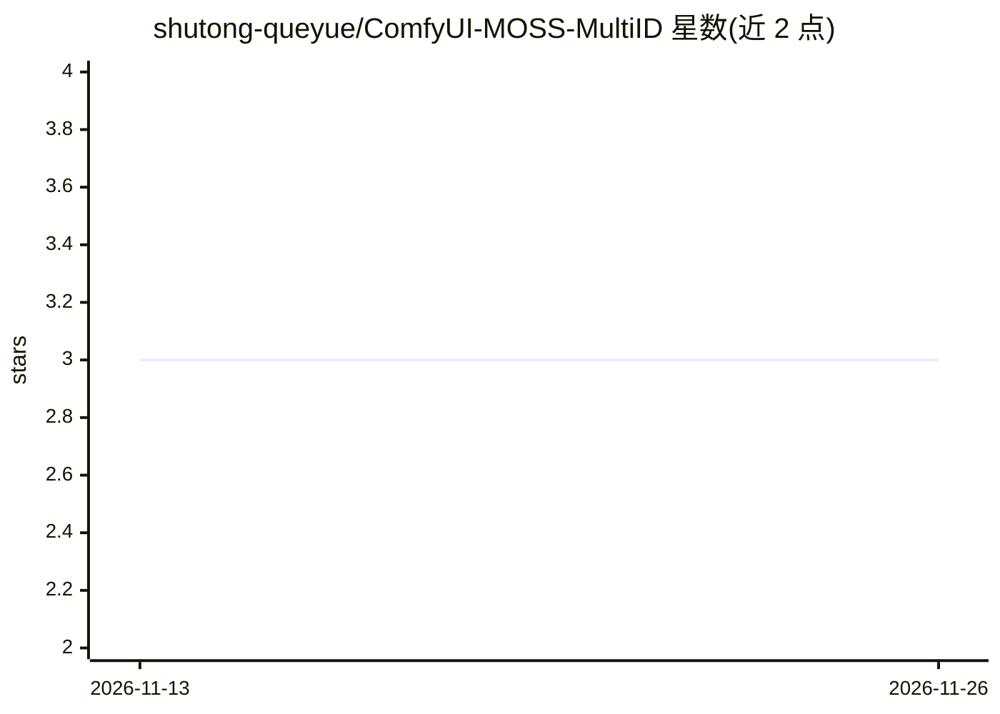

# shutong-queyue/ComfyUI-MOSS-MultiID

⭐ 3 · Python · MIT · 推送 2026-11-21 · [GitHub](https://github.com/shutong-queyue/ComfyUI-MOSS-MultiID) · [官网](https://registry.comfy.org/nodes/moss-multiid) · 个人维护 · 中文 README

**ComfyUI 节点：让 MOSS-Image 多角色 LoRA 各自只在指定画面区域生效**

面向 ComfyUI 用户的自定义节点包（共 12 个节点），解决 MOSS-Image 这类单流 DiT 模型中 LoRA 全局生效、常规区域控制节点静默失效的问题。做法是在注意力计算时按归属表逐格补写，让每个 LoRA 滤镜只作用于指定区域。提供两条链路：A 链路两趟采样并按真实人脸位置与逐人遮罩锁定身份；B 链路一次采样按手填方框分区，不依赖检脸。支持 SAM2 遮罩、小脸精修、边界过渡调整。插件不改 ComfyUI 本体与模型权重，删除文件夹即可还原。

## 筛选速览

| 维度 | 判定 | 备注 |
|---|---|---|
| AI 角色 | `ai-native` | 本体是模型或模型工具 |
| 许可风险 | `permissive` | MIT |
| 部署形态 | `None` |  |
| 模型依赖 | — | README 未给出锁定关系 |
| 硬件要求 | — | 无带数字的原话,不猜 |
| 安装摩擦 | `low` | 无编译、无系统依赖或容器化 |
| 成熟度 | — | 结构信号不足 |

## 能力要点

- 注意力逐格补写机制，不改模型权重即可分区生效
- A 链路两趟锁身份：按真实脸位与逐人 SAM2 遮罩自动分区
- B 链路一趟分区域：手填方框或画框工具连线，无需检脸
- 小脸裁剪放大/贴回精修链路，含清晰度补偿与软边贴合

## 适用场景

- 多人同框时让每个角色 LoRA 只换自己的脸不串脸
- 让风格滤镜只作用于画面某一块区域
- 给没有脸的主体（建筑、机器人、道具）做区域化风格控制
- 画面中人脸过小时做单独放大精修

## 场景标签

`图像生成` · 领域:内容生成

## 证据(README 行号)

> L3: 给 MOSS-Image 这类模型做**区域化的 LoRA**：挂上去的滤镜不再"全局一起改"，而是只在你指定的那块画面里起作用。
> L44: 本插件的做法：不把滤镜并进模型权重，而是在注意力计算时**逐格补一笔**，补多少由"这一格归谁"决定。所以：

## 星数曲线

2026-11-13 3 → 2026-11-26 3（+0）

---
*卡片 v1 · prompt 1.4 · 生成 2026-11-26 · 置信度 high · 依据 README sha `281384a1dfa2` · [字段定义](../../DATASET.md)*
