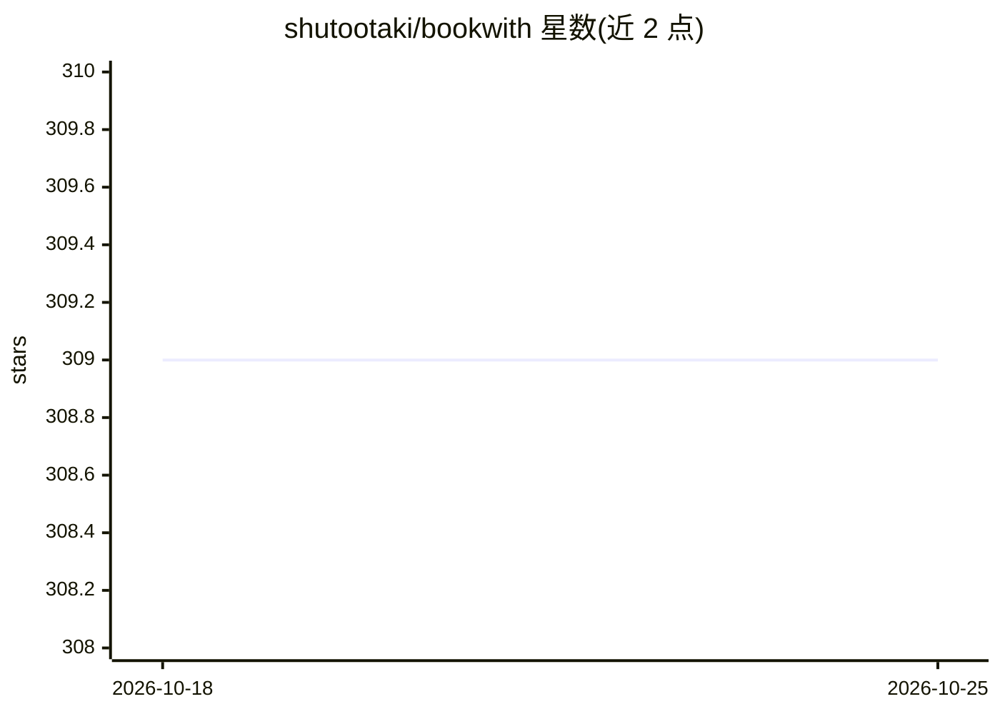

# shutootaki/bookwith

⭐ 309 · TypeScript · AGPL-3.0 · 推送 2026-05-10 · [GitHub](https://github.com/shutootaki/bookwith) · 个人维护 · 中文 README

**面向读者的 AI 对话式电子书阅读平台**

基于 Web 的 ePub 阅读器，AI 作为阅读伙伴：结合当前页面上下文回答提问、对高亮段落生成讨论，并可将书籍内容自动转写为主持人-嘉宾对话格式的 5-10 分钟播客（音频合成使用 Google Cloud Text-to-Speech 多说话人功能）。记忆系统分短期（最近5条）、中期（每20条摘要）、长期（向量检索）与用户画像四层，支持跨书语义搜索与 5 色高亮笔记。面向研究人员、书友、学生与商务人士；AI 功能需联网，支持 ePub 2.0/3.0，作为 Flow 的 fork 开发。

## 筛选速览

| 维度 | 判定 | 备注 |
|---|---|---|
| AI 角色 | `ai-native` | 本体是模型或模型工具 |
| 许可风险 | `viral` | AGPL-3.0 |
| 部署形态 | `None` |  |
| 模型依赖 | — | README 未给出锁定关系 |
| 硬件要求 | — | 无带数字的原话,不猜 |
| 安装摩擦 | `low` | 无编译、无系统依赖或容器化 |
| 成熟度 | — | 结构信号不足 |

## 能力要点

- 结合页面上下文的实时 AI 问答与深度讨论
- 书籍内容自动生成 5-10 分钟对话式播客（Google Cloud TTS 多说话人）
- 短期/中期/长期/用户画像四层记忆系统
- 跨书籍与对话历史的语义搜索和 5 色高亮智能标注

## 适用场景

- 读论文或书籍时即时向 AI 提问并验证理解
- 通勤时用生成的播客听取书籍要点
- 通过跨书语义搜索关联过去读过的内容

## 场景标签

`文档问答` `语音合成` `语义搜索` · 领域:内容生成

## 证据(README 行号)

> L14: BookWith is an innovative e-book reader where AI becomes your reading partner. By conversing with an AI that fully 
> L31: - ✅ AI answers your questions on the spot

## 星数曲线

2026-10-18 309 → 2026-10-25 309（+0）

---
*卡片 v1 · prompt 1.4 · 生成 2026-10-21 · 置信度 high · 依据 README sha `ab3938bcfe1b` · [字段定义](../../DATASET.md)*
