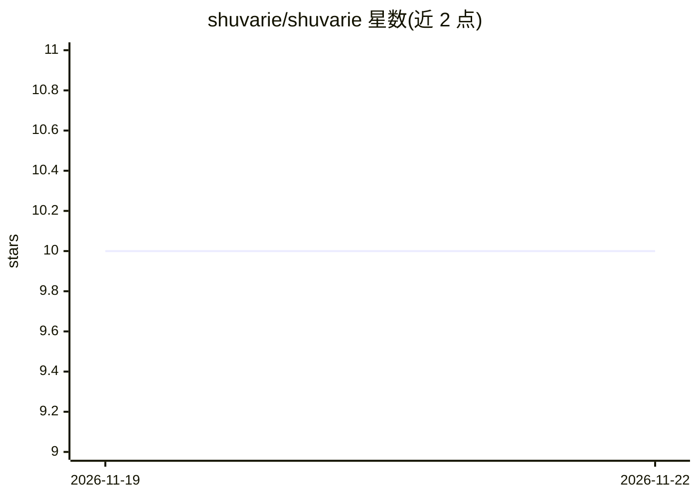

# shuvarie/shuvarie

⭐ 10 · Rust · MIT · 推送 2026-11-20 · [GitHub](https://github.com/shuvarie/shuvarie) · [官网](https://shuvarie.org) · 个人维护

**终端里的 AI 编程 Agent：Rust TUI，读写文件与运行命令需用户许可**

基于 Rust 编写的终端 TUI AI 编程 Agent：围绕 agentic loop 提供文件读写、补丁生成、grep/glob 检索、fuzzy find、LSP 诊断、网络抓取与 shell 执行，所有工具调用经权限门控（允许/拒绝/询问）。支持多 provider 配置（connections.kdl）、场景切换（Advisor/Reviewer/Orchestrator）、子 agent 委派、多标签多项目并行、对话树分支与 undo/replay、上下文摘要压缩、SKILL.md 技能加载、MCP/stdio 接入及附件（文档/图片）解析。安装通过 Nix 或 cargo 从源码构建。

## 筛选速览

| 维度 | 判定 | 备注 |
|---|---|---|
| AI 角色 | `ai-native` | 本体是模型或模型工具 |
| 许可风险 | `permissive` | MIT |
| 部署形态 | `library` | 以包/库形式分发 |
| 模型依赖 | local-ok | 支持本地模型 |
| 硬件要求 | — | 无带数字的原话,不猜 |
| 安装摩擦 | `low` | 无编译、无系统依赖或容器化 |
| 成熟度 | — | 结构信号不足 |

## 能力要点

- 工具调用权限门控：每个调用可允许、拒绝或交由用户确认
- 多 provider 支持：OpenAI、Anthropic、Gemini、Ollama 及 OpenAI 兼容端点
- 多标签并行会话与对话树分支（/tree、/undo、/replay）
- 子 agent 编排（Orchestrator 场景）与 SKILL.md 技能加载

## 适用场景

- 在终端中让 AI Agent 代为修改代码和运行命令
- 多项目并行对话，各标签独立会话
- 通过子 agent 将设计规划与执行任务拆分委派
- 加载自定义 SKILL.md 扩展 Agent 能力

## 场景标签

`编码 Agent` · 领域:编码与开发

## 证据(README 行号)

> L20: > In the plain tongue of innkeepers — the one that runs without dice — Shuvarie is a terminal-based AI coding agent
> L28: - **Send a fully armed knight** — it reads and writes scrolls (files), forges patches, scrys with grep and glob, hu
> L29: - **Rule by the code of chivalry** — every tool call passes the permission wards: allowed, denied, or brought befor

## 星数曲线

2026-11-19 10 → 2026-11-22 10（+0）

---
*卡片 v1 · prompt 1.4 · 生成 2026-11-19 · 置信度 high · 依据 README sha `20a381ca653a` · [字段定义](../../DATASET.md)*
