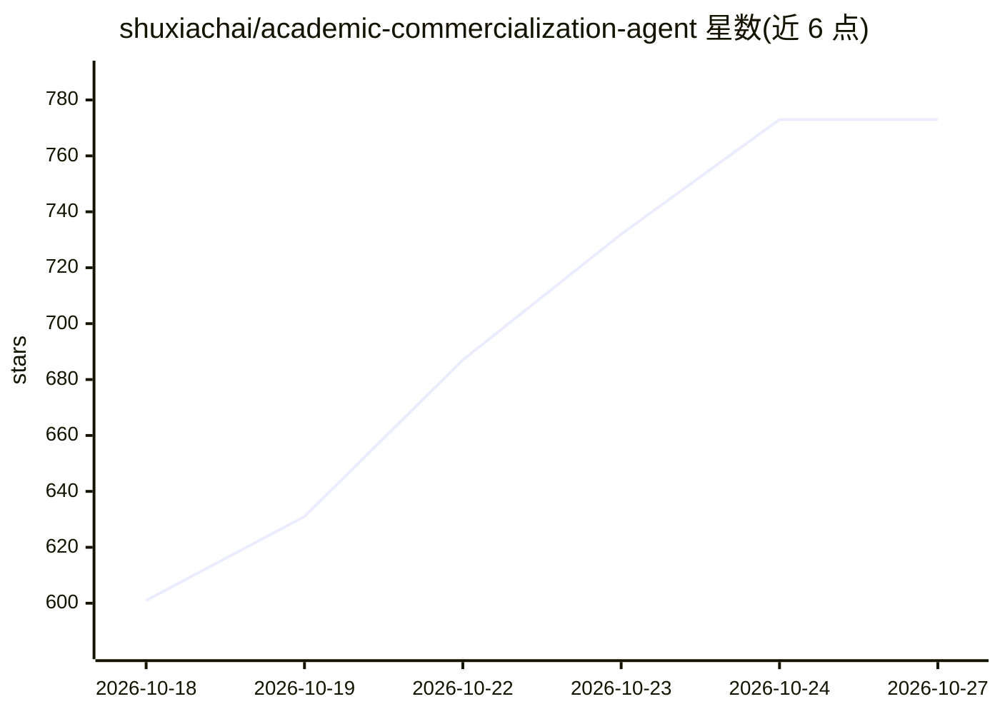

# shuxiachai/academic-commercialization-agent

⭐ 773 · Python · MIT · 推送 2026-10-26 · [GitHub](https://github.com/shuxiachai/academic-commercialization-agent) · [官网](https://academic-commercialization-agent.up.railway.app) · 个人维护 · 中文 README

**把论文/课题转化为带引用的成果转化评估报告的多智能体应用**

基于 CrewAI + FastAPI 的 Web 应用：用户提交研究课题或论文 PDF，确定性代码先检索并验证来源形成冻结证据库，随后六个 LLM 阶段生成覆盖 TRL、制造成熟度、专利强度、市场可达性与证据置信度的评分卡，加权总分由代码计算。支持断点恢复、按 ID 检索已存来源、导出 Markdown/PDF。运行需 LLM API key（Qwen/DeepSeek/Anthropic/OpenAI 可选）与 Tavily 或 Serper 搜索 key；提供 10 主题 × 3 次重复的可复现基准。声明为研究分诊用途，非正式尽调，且限单副本部署。

## 筛选速览

| 维度 | 判定 | 备注 |
|---|---|---|
| AI 角色 | `ai-native` | 本体是模型或模型工具 |
| 许可风险 | `permissive` | MIT |
| 部署形态 | `None` |  |
| 模型依赖 | — | README 未给出锁定关系 |
| 硬件要求 | — | 无带数字的原话,不猜 |
| 安装摩擦 | `low` | 无编译、无系统依赖或容器化 |
| 成熟度 | — | 结构信号不足 |

## 能力要点

- 确定性检索验证先行，LLM 仅对冻结证据推理
- TRL/MRL/专利/市场/证据置信度评分卡，加权分由代码计算
- 内容寻址检查点与中断恢复，付费请求 24 小时内可凭回执恢复
- 附带可复现基准：10 主题 × 3 次重复与两组 held-out 检验

## 适用场景

- 科研人员或技术转移人员快速评估论文的商业化可行性
- 为技术成熟度与专利态势生成带引用的初稿报告
- 在不调用模型的情况下浏览历史示例报告

## 场景标签

`多智能体` `科研工具` · 领域:Agent 开发

## 证据(README 行号)

> L3: Turn a paper or research topic into a **source-linked commercialization assessment draft**:
> L23: Built with Python, CrewAI, FastAPI and a build-free JavaScript client.
> L36: - Deterministic code retrieves and validates sources first; six LLM stages

## 星数曲线

2026-10-18 601 → 2026-10-27 773（+172）

---
*卡片 v1 · prompt 1.4 · 生成 2026-10-21 · 置信度 high · 依据 README sha `a463a2222b43` · [字段定义](../../DATASET.md)*
