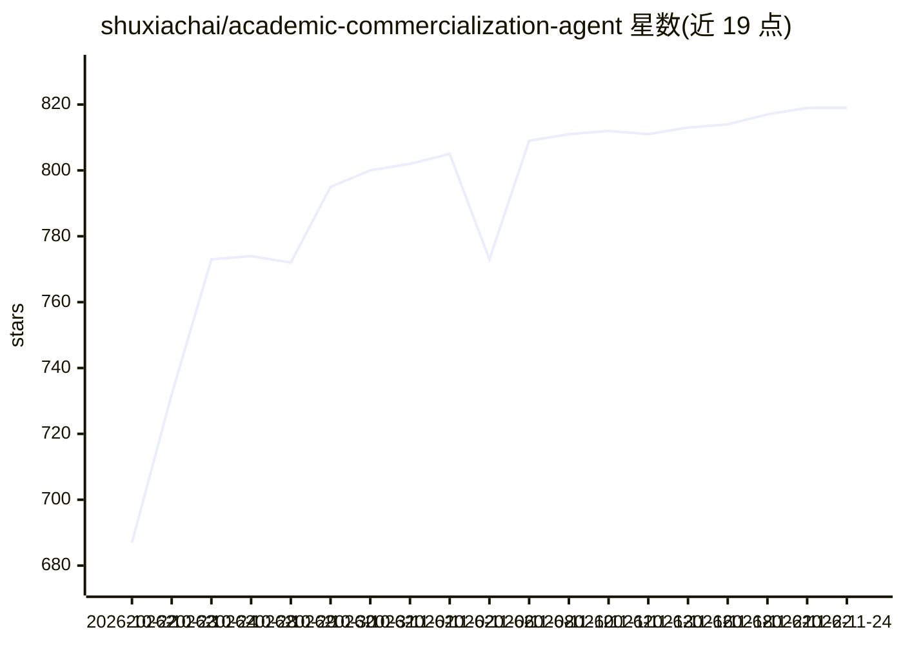

# shuxiachai/academic-commercialization-agent

⭐ 819 · Python · MIT · 推送 2026-11-22 · [GitHub](https://github.com/shuxiachai/academic-commercialization-agent) · [官网](https://academic-agent.cc) · 个人维护 · 中文 README

**把研究论文转化为带引用的商业化/技术转移评估报告**

多 agent LLM 流水线：输入研究主题或论文 PDF，先由确定性代码检索、验证并冻结来源注册表，再由六个 LLM 阶段（三个证据专家并行，Writer/Reviewer/Scorer 串行）在该注册表上推理，评分卡覆盖 TRL、MRL、专利强度、市场可及性与证据置信度，加权总分由代码而非模型计算。基于 CrewAI + FastAPI 与无构建 JS 客户端，支持检查点恢复、付费请求回执、运行对比与 Markdown/PDF 导出；报告仅用于研究分诊，不构成技术、法律或投资尽调。

## 筛选速览

| 维度 | 判定 | 备注 |
|---|---|---|
| AI 角色 | `ai-native` | 本体是模型或模型工具 |
| 许可风险 | `permissive` | MIT |
| 部署形态 | `None` |  |
| 模型依赖 | — | README 未给出锁定关系 |
| 硬件要求 | — | 无带数字的原话,不猜 |
| 安装摩擦 | `low` | 无编译、无系统依赖或容器化 |
| 成熟度 | — | 结构信号不足 |

## 能力要点

- 证据先行：确定性检索与验证冻结来源，LLM 仅在注册表上推理
- 评分加权总分由代码计算，报告带来源引用与可靠性警告
- 中断运行从已验证检查点恢复为链接运行，付费请求有 24 小时回执
- 仓库公开基准协议与实测结果（30 次冻结基线、两轮 held-out 验证）

## 适用场景

- 技术转移办公室决定是否许可某项技术前的初步分诊
- 对研究主题生成带引用的 TRL/专利/市场/风险评分卡
- 比较两次评估运行的评分差异

## 场景标签

`多智能体` `科研工具` · 领域:Agent 开发

## 证据(README 行号)

> L3: **Paper in, cited commercialization triage out.** A multi-agent LLM pipeline
> L66: - Deterministic code retrieves and validates sources first; six LLM stages
> L69:  evidence confidence. The weighted total is computed by code, not the model.

## 星数曲线

2026-10-22 687 → 2026-11-24 819（+132）

---
*卡片 v1 · prompt 1.4 · 生成 2026-11-24 · 置信度 high · 依据 README sha `bfb6caba6bbb` · [字段定义](../../DATASET.md)*
