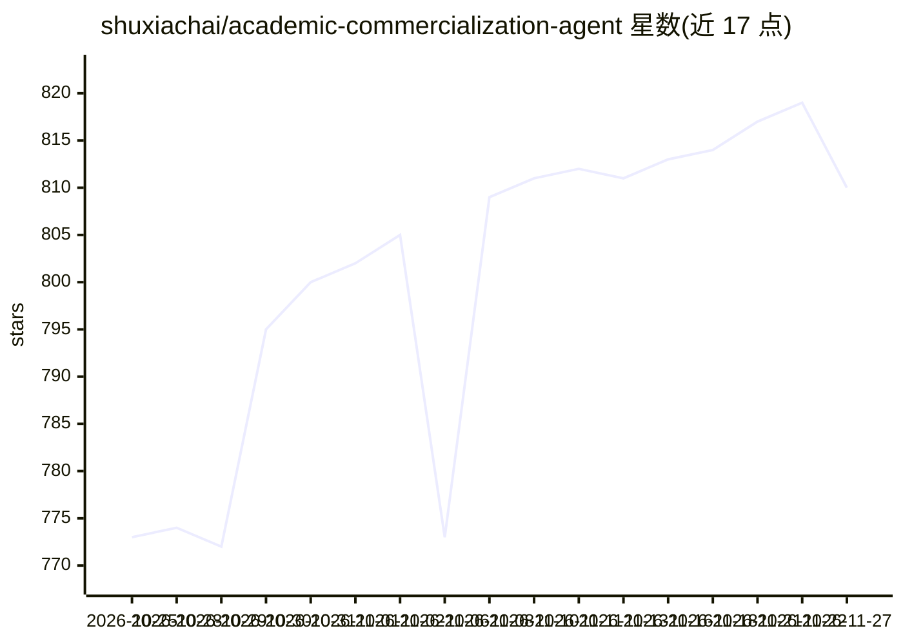

# shuxiachai/academic-commercialization-agent

⭐ 810 · Python · MIT · 推送 2026-11-26 · [GitHub](https://github.com/shuxiachai/academic-commercialization-agent) · [官网](https://academic-agent.cc) · 个人维护 · 中文 README

**把研究论文转化为带引用的商业化/技术转移评估的多智能体工具**

基于 CrewAI 与 FastAPI 构建的多智能体流水线：提交研究主题或论文 PDF 后，先由确定性代码检索、校验并冻结来源注册表，再由六个 LLM 阶段基于该证据推理，输出覆盖 TRL、MRL、专利强度、市场可及性与证据置信度的评分卡，加权总分由代码而非模型计算。支持断点续跑（新链式运行）、付费请求回执与 24 小时恢复、Markdown/PDF 导出与运行对比。仓库内含冻结基准、留出校验与消融实验的协议和结果。README 明确声明报告仅支持研究筛选，不构成技术、法律或投资尽调。

## 筛选速览

| 维度 | 判定 | 备注 |
|---|---|---|
| AI 角色 | `ai-native` | 本体是模型或模型工具 |
| 许可风险 | `permissive` | MIT |
| 部署形态 | `None` |  |
| 模型依赖 | — | README 未给出锁定关系 |
| 硬件要求 | — | 无带数字的原话,不猜 |
| 安装摩擦 | `low` | 无编译、无系统依赖或容器化 |
| 成熟度 | — | 结构信号不足 |

## 能力要点

- 确定性检索与证据冻结在先，六阶段 LLM 推理在后，加权总分由代码计算
- 中断运行可从最后一个已校验检查点恢复为链式新运行，付费请求有回执
- 公开基准协议与结果：10 主题×3 重复基线、留出校验、90 格拓扑消融
- 评分卡覆盖 TRL、MRL、专利强度、市场可及性与证据置信度

## 适用场景

- 技术转移办公室评估是否许可某项研究技术
- 对研究论文做商业化初步筛选并生成带引用的评分卡
- 对比两次评估运行的评分差异与证据来源

## 场景标签

`多智能体` `科研工具` · 领域:Agent 开发

## 证据(README 行号)

> L3: **Paper in, cited commercialization triage out.** A multi-agent LLM pipeline
> L48: Built with Python, CrewAI, FastAPI and a build-free JavaScript client.
> L66: - Deterministic code retrieves and validates sources first; six LLM stages

## 星数曲线

2026-10-25 773 → 2026-11-27 810（+37）

---
*卡片 v1 · prompt 1.4 · 生成 2026-11-25 · 置信度 high · 依据 README sha `cc24f667f509` · [字段定义](../../DATASET.md)*
