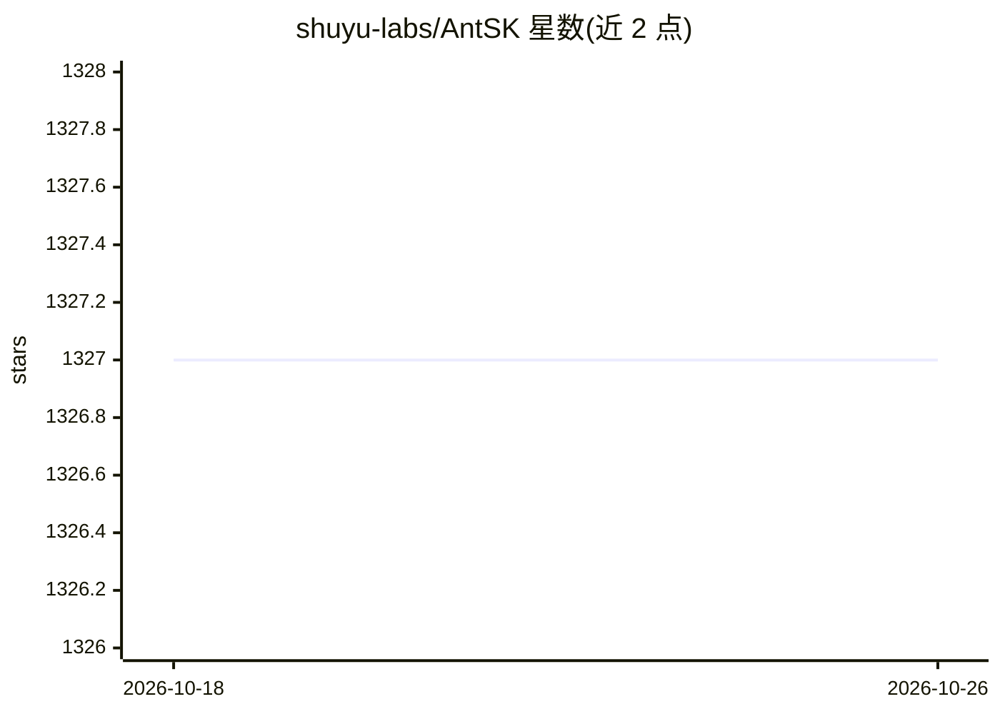

# shuyu-labs/AntSK

⭐ 1,327 · CSS · NOASSERTION · 推送 2026-09-20 · [GitHub](https://github.com/shuyu-labs/AntSK) · [官网](https://antsk.cn) · 组织维护 · 中文 README

**面向企业的 .NET 9 AI 知识库/智能体平台，支持全链路离线**

基于 .NET 9 + Blazor + Semantic Kernel + Kernel Memory 构建的企业级 AI 知识库与智能体平台。支持导入 Word/PDF/Excel/PPT 等文档构建 RAG 知识库问答，配合 BGE embedding/rerank；可接入 OpenAI、Azure OpenAI、讯飞星火、阿里云等云端模型，或通过 Ollama、LlamaFactory、llama.cpp(GGUF) 实现完全断网的本地离线运行；提供 API 发布、.NET/DLL 插件、API 插件、StableDiffusion 文生图、OCR。开源版免费商用（需保留 logo 版权），另有 AntSK Pro 商业版；Docker 或 dotnet run 部署，默认 SQLite+Disk 零配置启动。

## 筛选速览

| 维度 | 判定 | 备注 |
|---|---|---|
| AI 角色 | `ai-native` | 本体是模型或模型工具 |
| 许可风险 | `none` | NOASSERTION |
| 部署形态 | `desktop` | 安装包/桌面程序 |
| 模型依赖 | local-ok | 支持本地模型 |
| 硬件要求 | — | 无带数字的原话,不猜 |
| 安装摩擦 | `low` | 无编译、无系统依赖或容器化 |
| 成熟度 | — | 结构信号不足 |

## 能力要点

- RAG 知识库问答，支持本地 BGE embedding/rerank，全链路可断网离线
- 云端（OpenAI/Azure/讯飞星火/阿里云）与本地（Ollama/LlamaFactory/llama.cpp GGUF）多模型接入
- API 发布、.NET DLL 插件与 API 插件系统，支持二次开发
- 内置 RBAC/多租户，兼容国产模型与国产数据库（含达梦）

## 适用场景

- 企业在内网搭建私有知识库问答系统，数据不出内网
- .NET/C# 团队构建和二次开发 AI 智能体应用
- 政企信创环境部署国产化 AI 知识库

## 场景标签

`文档问答` `RAG` · 领域:知识与检索

## 证据(README 行号)

> L12: > **AntSK（Ant Semantic Kernel）是一个基于 .NET 9 与 Blazor 技术栈构建的企业级 AI 知识库与智能体平台，集成 Semantic Kernel 和 Kernel Memory，支持本地离
> L125: - **知识库**：通过文档（Word、PDF、Excel、Txt、Markdown、Json、PPT）等形式导入知识库，可以进行知识库问答，支持本地bge-embedding 向量模型 ，以及bge-rerank 重排模型。
> L33: 2. **数据不出内网**：支持 Ollama、LLamaFactory、llama.cpp(GGUF) 三类本地推理引擎，配合本地 BGE embedding / rerank，可完全断网运行，满足金融、政务、医疗、军工等数据敏

## 星数曲线

2026-10-18 1,327 → 2026-10-26 1,327（+0）

---
*卡片 v1 · prompt 1.4 · 生成 2026-10-21 · 置信度 mid · 依据 README sha `7e108c6e8b98` · [字段定义](../../DATASET.md)*
