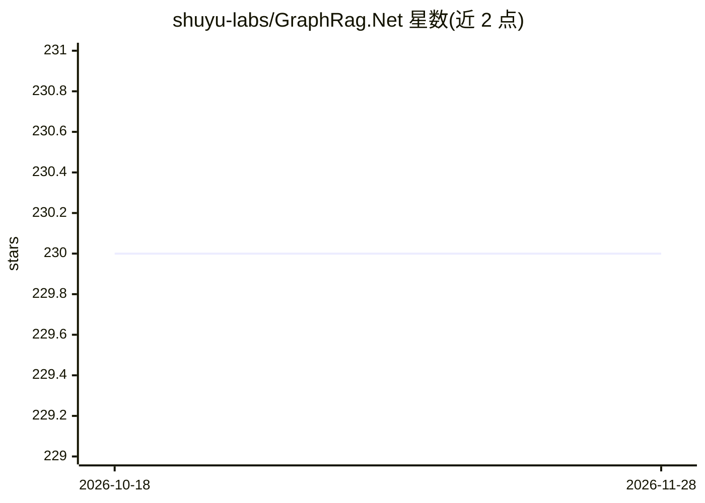

# shuyu-labs/GraphRag.Net

⭐ 230 · C# · Apache-2.0 · 推送 2026-11-15 · [GitHub](https://github.com/shuyu-labs/GraphRag.Net) · [官网](https://antsk.cn) · 个人维护 · 中文 README

**给 .NET 开发者提供参考 GraphRAG 思路的 RAG 集成库**

参考微软 GraphRAG 论文思路的 .NET 实现，基于 Semantic Kernel 构建：覆盖文档切片、图节点与边抽取、社区检测（加权 LPA 近似）、社区摘要、Local/Global/DRIFT 检索、Claims 抽取、增量索引与自动提示词调优。以 NuGet 包或自带 API 服务/Blazor UI 两种方式交付；LLM 接口仅兼容 OpenAI 规范，接入其他模型需自定义 Kernel 实现；精确 Leiden 与 tiktoken 采用近似实现。README 声明本项目为 demo 示例，用于学习 GraphRAG 思路。

## 筛选速览

| 维度 | 判定 | 备注 |
|---|---|---|
| AI 角色 | `ai-ecosystem` | LLM/agent 周边工具 |
| 许可风险 | `permissive` | Apache-2.0 |
| 部署形态 | `None` |  |
| 模型依赖 | — | README 未给出锁定关系 |
| 硬件要求 | — | 无带数字的原话,不猜 |
| 安装摩擦 | `medium` | 含编译或系统依赖之一 |
| 成熟度 | `idea` | |

## 能力要点

- 提供 Basic/Global(Map-Reduce)/Local/DRIFT 四种检索模式及流式版本
- 增量索引按内容哈希检测变更，跳过未变块并重建社区
- 内置零外部依赖的离线回归测试（57 项检查），无需 API Key 可重复
- 同时提供 NuGet 包、Swagger API 服务与 Blazor 界面

## 适用场景

- 在 .NET 项目中通过 NuGet 集成 GraphRAG 检索能力
- 学习 GraphRAG 的文档切片、社区检测与全局摘要流程
- 搭建带知识图谱查看与问答对话界面的 RAG 服务

## 场景标签

`RAG` `知识图谱` · 领域:知识与检索

## 证据(README 行号)

> L3: ## 这是一个参考GraphRag的dotnet简易实现
> L129: 出于方便，LLM接口目前只兼容了openai的规范，其他大模型可以考虑使用one-api类的集成产品
> L198: dotnet add package GraphRag.Net

## 星数曲线

2026-10-18 230 → 2026-11-28 230（+0）

---
*卡片 v1 · prompt 1.4 · 生成 2026-11-25 · 置信度 high · 依据 README sha `7e13024b50d0` · [字段定义](../../DATASET.md)*
