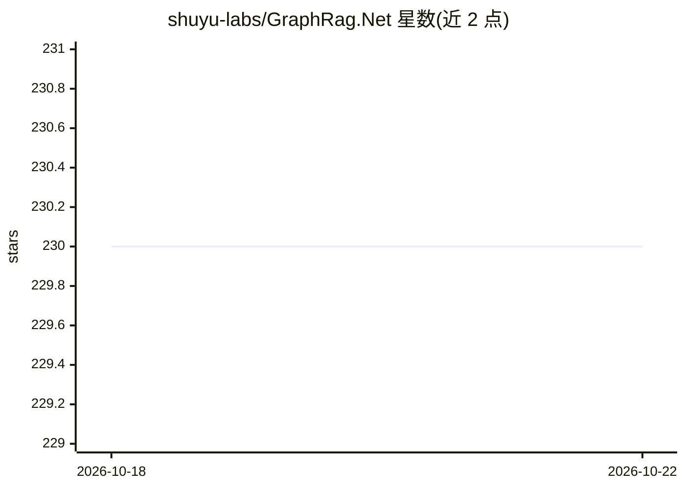

# shuyu-labs/GraphRag.Net

⭐ 230 · C# · Apache-2.0 · 推送 2025-10-28 · [GitHub](https://github.com/shuyu-labs/GraphRag.Net) · [官网](https://antsk.cn) · 个人维护 · 中文 README

**基于 Semantic Kernel 的 GraphRAG .NET 实现库，供学习与集成**

参考 GraphRAG 论文思路、以 .NET + Semantic Kernel 实现的图谱 RAG 库：将文档切片、抽取图节点与边、生成摘要，用快速标签传播算法做社区检测，社区/图谱摘要汇总生成全局答案；支持向量搜索（阈值 0.5 降级 0.3）、token 超限裁剪与孤立节点补连。以 NuGet 包或 ASP.NET Core Web 项目（swagger API + Blazor UI）两种方式提供，LLM 接口目前只兼容 OpenAI 规范，可抽象 Kernel 自定义接入。README 自述为 demo 示例、仅用于学习 GraphRAG 思路。

## 筛选速览

| 维度 | 判定 | 备注 |
|---|---|---|
| AI 角色 | `ai-ecosystem` | LLM/agent 周边工具 |
| 许可风险 | `permissive` | Apache-2.0 |
| 部署形态 | `None` |  |
| 模型依赖 | — | README 未给出锁定关系 |
| 硬件要求 | — | 无带数字的原话,不猜 |
| 安装摩擦 | `medium` | 含编译或系统依赖之一 |
| 成熟度 | `idea` | |

## 能力要点

- GraphRAG 全流程实现：切片→元素抽取→摘要→社区检测→全局答案
- 快速标签传播算法（10 次迭代）社区检测
- NuGet 包开箱集成，另提供 Web API 与 Blazor 界面
- LLM 接口兼容 OpenAI 规范，Kernel 可自定义扩展

## 适用场景

- 在 .NET 项目中集成 GraphRAG 图谱问答能力
- 学习 GraphRAG 的实现流程与算法细节
- 通过自带 UI 导入文本/文件并查看知识图谱问答

## 场景标签

 · 领域:LLM 基础设施/知识图谱 RAG

## 证据(README 行号)

> L3: ## 这是一个参考GraphRag的dotnet简易实现
> L74: ## 您可以直接在项目中引用NuGet包，或者直接使用本项目提供API服务
> L76: 出于方便，LLM接口目前只兼容了openai的规范，其他大模型可以考虑使用one-api类的集成产品

## 星数曲线

2026-10-18 230 → 2026-10-22 230（+0）

---
*卡片 v1 · prompt 1.4 · 生成 2026-10-22 · 置信度 high · 依据 README sha `ba041ac613ef` · [字段定义](../../DATASET.md)*
