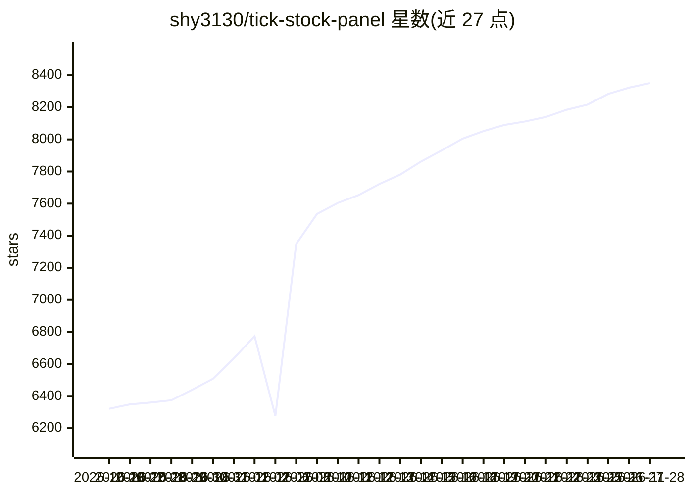

# shy3130/tick-stock-panel

⭐ 8,351 · Python · MIT · 推送 2026-11-27 · [GitHub](https://github.com/shy3130/tick-stock-panel) · [官网](https://tsp.shy313.com) · 个人维护 · 中文 README

**自托管 A 股量化工作台：策略、监控、回测与 AI 助手一体化**

面向本地量化学习与研究的工作台，功能覆盖数据源切换、因子与策略筛选、回测验证、盘中监控与模拟盘。内置 AI 助手可查询本地行情、起草策略、运行回测，并通过 Open API 与 MCP 供外部脚本和 AI 客户端按权限调用。数据经 Tivelo Data 引擎采集与版本化，回测由 Tivelo Backtest 按 A 股 T+1、涨跌停和费用约束模拟。工作台采用 MIT 许可，Tivelo 组件按 PolyForm 非商业许可授权。

## 筛选速览

| 维度 | 判定 | 备注 |
|---|---|---|
| AI 角色 | `ai-enhanced` | 去掉 AI 部分产品仍成立 |
| 许可风险 | `permissive` | MIT |
| 部署形态 | `self-host` | docker 或自建部署 |
| 模型依赖 | — | README 未给出锁定关系 |
| 硬件要求 | — | 无带数字的原话,不猜 |
| 安装摩擦 | `low` | 无编译、无系统依赖或容器化 |
| 成熟度 | — | 结构信号不足 |

## 能力要点

- 日 K、分钟 K、实时行情与除权因子可分别切换数据源
- AI 助手在面板内取数、起草策略和运行回测，工具调用记录可核对
- Open API 与 MCP 按 Token 权限开放行情、策略与回测接口
- 回测按 A 股 T+1、涨跌停与交易费用约束模拟成交

## 适用场景

- 在本地搭建 A 股策略筛选、回测与盘中监控工作流
- 通过 AI 助手查询行情并起草策略
- 把工作台接入自己的脚本或 AI 客户端做策略研究
- 用快照数据固定行情做策略复跑与归档

## 场景标签

`金融量化` `AI 助手` · 领域:对话与助手

## 证据(README 行号)

> L35: > **TSP 面向本地量化学习与研究。** 项目走独立的研究工作台路线，不对标同花顺、通达信等投资及看盘软件。AI 助手用于取数、分析和策略研究，产品范围不含 AI 荐股与涨停预测。行情数据可通过插件接入第三方来源。
> L74: 脚本和外部 AI 可通过 **Open API 或 MCP** 按权限读取行情、查询策略和提交回测。AI 接入指南
> L91: |**工作台 AI 助手**|在面板内查询本地行情、起草策略和运行回测。助手与开放接口|

## 星数曲线

2026-10-26 6,321 → 2026-11-28 8,351（+2,030）

---
*卡片 v1 · prompt 1.4 · 生成 2026-11-28 · 置信度 high · 依据 README sha `d670355998bd` · [字段定义](../../DATASET.md)*
