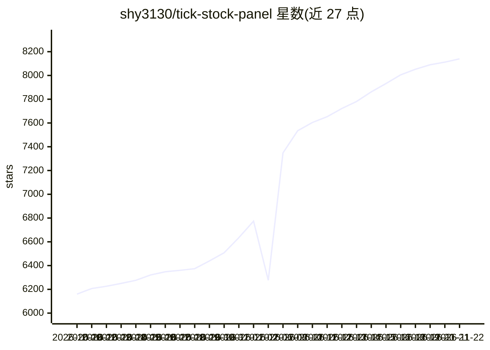

# shy3130/tick-stock-panel

⭐ 8,140 · Python · MIT · 推送 2026-11-21 · [GitHub](https://github.com/shy3130/tick-stock-panel) · [官网](https://tsp.shy313.com) · 个人维护 · 中文 README

**A股个人量化自托管工作台：策略+回测+监控+AI助手**

自托管、单容器部署的 A 股量化工作台，覆盖数据接入、策略引擎、因子挖掘与回测、盘中异动监控与推送、AI 对话助手与复盘。核心机制包括：6 类数据集按源能力独立路由的能力路由矩阵（换源不换口径）、统一 enriched Parquet 数据口径、Parquet+DuckDB 文件型存储（零外部数据库）、65 端点开放 API 与 12 工具的 MCP 服务器。README 声明不作为投资或看盘软件，不内置 AI 荐股与涨停预测，仅供学习研究。AI 功能为可选，需 OpenAI 兼容接口且依赖工具调用能力。

## 筛选速览

| 维度 | 判定 | 备注 |
|---|---|---|
| AI 角色 | `ai-enhanced` | 去掉 AI 部分产品仍成立 |
| 许可风险 | `permissive` | MIT |
| 部署形态 | `desktop` | 安装包/桌面程序 |
| 模型依赖 | local-ok | 支持本地模型 |
| 硬件要求 | — | 无带数字的原话,不猜 |
| 安装摩擦 | `low` | 无编译、无系统依赖或容器化 |
| 成熟度 | — | 结构信号不足 |

## 能力要点

- 自托管单容器零外部数据库，数据全部落本地 Parquet/DuckDB
- 能力路由矩阵：数据源插件化，换源不换口径
- 65 端点开放 API + MCP 服务器（12 工具，按 scope 暴露）
- AI 对话助手：21 个查询工具 + 5 个确认放行动作，取数足迹可核对

## 适用场景

- 自建 A 股策略并本地回测验证
- 盘中异动监控与飞书/语音告警
- 用自然语言查询面板数据并触发回测/补数
- 通过 MCP 把面板能力接入自己的 AI 客户端

## 场景标签

`金融量化` · 领域:学习与行业

## 证据(README 行号)

> L13: **自托管 · 零运维 · 核心能力全部开放成接口的 A 股量化工作台**
> L174: |**AI**(可选)|OpenAI兼容 Chat Completions 与 Responses 双协议 · DeepSeek / 通义 / Ollama 等 · 策略生成 / 报告 / **对话助手**(助手依赖工具调用能力
> L46: > ⚠️ 本项目谨作为本地量化提供解决思路与方案，**不作为投资软件或者看盘软件**。**明确不做**：不对标同花顺 / 通达信，不内置「AI 荐股 / 涨停预测」。数据源已插件化，可任意接入第三方数据源。仅供学习研究使用。

## 星数曲线

2026-10-20 6,160 → 2026-11-22 8,140（+1,980）

---
*卡片 v1 · prompt 1.4 · 生成 2026-11-22 · 置信度 mid · 依据 README sha `4fe061a1a1aa` · [字段定义](../../DATASET.md)*
