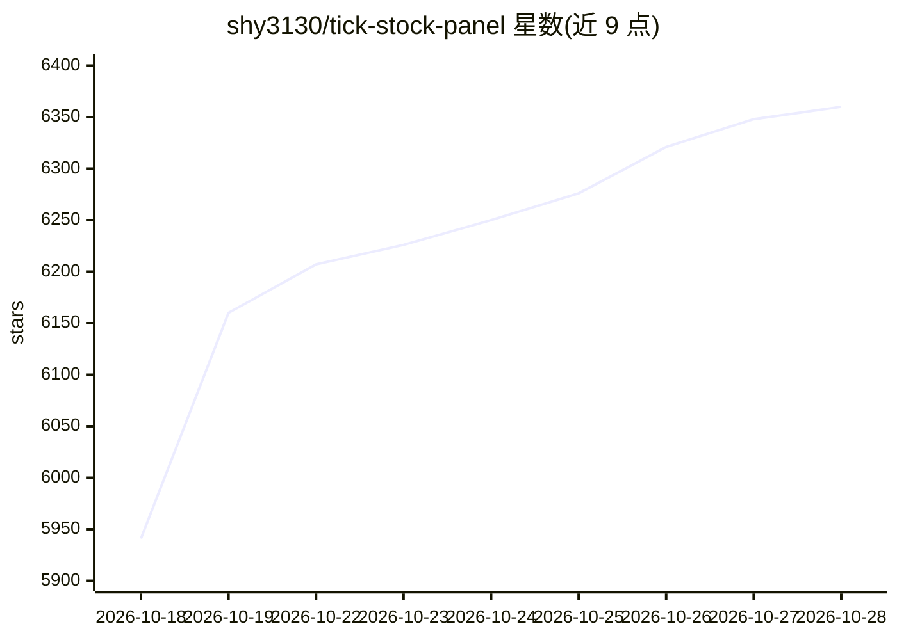

# shy3130/tick-stock-panel

⭐ 6,360 · Python · MIT · 推送 2026-10-27 · [GitHub](https://github.com/shy3130/tick-stock-panel) · [官网](https://tsp.shy313.com) · 个人维护 · 中文 README

**自托管 A 股量化工作台：策略+回测+监控+AI 助手**

个人开源的自托管 A 股量化分析平台，单 Docker 容器部署，数据以 Parquet+DuckDB 落在本地，零外部数据库。功能覆盖能力路由多数据源、自定义策略与毫秒级全市场扫描、因子挖掘与回测、异动监控与推送、65 端点开放 API 与 12 工具 MCP 服务器。AI 为可选扩展：OpenAI 兼容协议接入 DeepSeek/通义/Ollama，提供对话取数助手、AI 策略生成与个股四维分析；未配置 Key 时 fail-closed，删除目录即可卸载。README 声明不作为投资软件，不内置 AI 荐股。

## 筛选速览

| 维度 | 判定 | 备注 |
|---|---|---|
| AI 角色 | `ai-enhanced` | 去掉 AI 部分产品仍成立 |
| 许可风险 | `permissive` | MIT |
| 部署形态 | `desktop` | 安装包/桌面程序 |
| 模型依赖 | local-ok | 支持本地模型 |
| 硬件要求 | — | 无带数字的原话,不猜 |
| 安装摩擦 | `low` | 无编译、无系统依赖或容器化 |
| 成熟度 | — | 结构信号不足 |

## 能力要点

- 65 端点开放 API（六档 Token scope）+ 12 工具 MCP 服务器
- 插件化数据源 + 能力路由矩阵，换源不换回测口径
- AI 对话助手：21 个查询工具 + 4 个动作工具（确认卡放行），取数过程可核对
- 单容器自托管，数据全部落本地 Parquet，无外部数据库

## 适用场景

- 自己搭一套 A 股策略、回测与监控一体的本地工作台
- 把面板数据通过 Open API/MCP 接给自己的脚本或 AI 客户端
- 用 AI 对话助手一句话查全站行情、财务与信号数据

## 场景标签

`金融量化` · 领域:学习与行业

## 证据(README 行号)

> L178: |**AI**(可选)|OpenAI兼容 Chat Completions 与 Responses 双协议 · DeepSeek / 通义 / Ollama 等 · 策略生成 / 报告 / **对话助手**(助手依赖工具调用能力
> L127: - 你看到的 19 个页面里,**11 个官方页面本身就是扩展**(单文件 `frontend/src/custom/<ns>/extension.tsx`)—— 监控中心页面可以整个换掉,规则引擎与推送管道属核心照常运行。**

## 星数曲线

2026-10-18 5,941 → 2026-10-28 6,360（+419）

---
*卡片 v1 · prompt 1.4 · 生成 2026-10-20 · 置信度 mid · 依据 README sha `1fe12d237cf0` · [字段定义](../../DATASET.md)*
