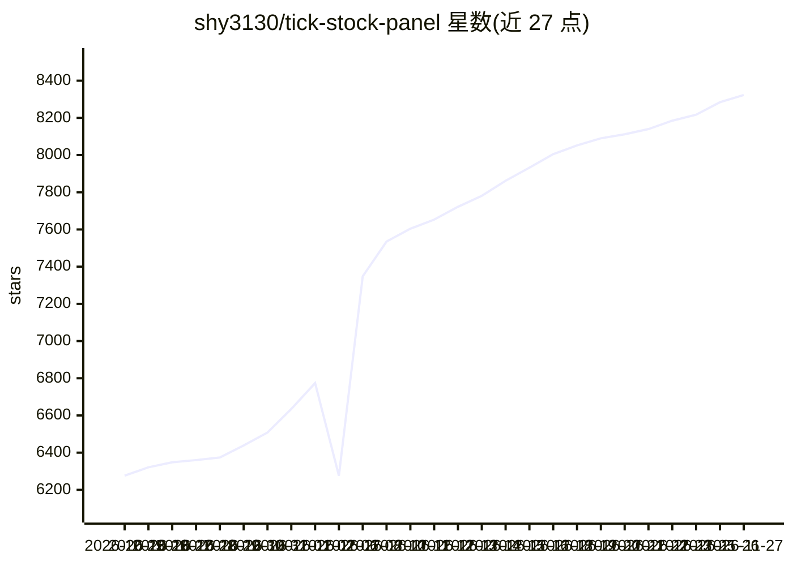

# shy3130/tick-stock-panel

⭐ 8,323 · Python · MIT · 推送 2026-11-26 · [GitHub](https://github.com/shy3130/tick-stock-panel) · [官网](https://tsp.shy313.com) · 个人维护 · 中文 README

**自托管 A 股量化研究工作台：策略+监控+回测+AI 助手**

面向本地量化学习与研究的自托管工作台，覆盖看板、因子与策略筛选、回测验证、盘中监控与模拟盘。内置 Tivelo Data 数据引擎与 Tivelo Backtest 回测引擎（后者按 T+1、涨跌停、费用约束模拟撮合），计算内核基于 Polars 的 Rust 列式引擎。日 K、分钟 K、实时行情可分别配置第三方数据源，页面、策略、插件通过 SDK 与资源包扩展。工作台 AI 助手可取数、起草策略与运行回测，并经 Open API/MCP 供外部脚本与 AI 客户端调用。Docker、桌面安装包与源码三种运行方式；Tivelo 组件采用 PolyForm 非商业许可。

## 筛选速览

| 维度 | 判定 | 备注 |
|---|---|---|
| AI 角色 | `ai-enhanced` | 去掉 AI 部分产品仍成立 |
| 许可风险 | `permissive` | MIT |
| 部署形态 | `self-host` | docker 或自建部署 |
| 模型依赖 | — | README 未给出锁定关系 |
| 硬件要求 | — | 无带数字的原话,不猜 |
| 安装摩擦 | `low` | 无编译、无系统依赖或容器化 |
| 成熟度 | — | 结构信号不足 |

## 能力要点

- 日 K/分钟 K/实时行情/除权因子可分别选择数据源，扩展表支持定时拉取与历史回补
- Tivelo Backtest 按 A 股 T+1、涨跌停和费用约束模拟撮合，支持滚动样本外验证
- AI 助手在面板内取数、起草策略与运行回测，Open API 与 MCP 按 Token 权限开放
- Page Pack SDK 与插槽机制支持页面、策略、图表指标及后端插件扩展

## 适用场景

- 在本地自建 A 股策略并做参数筛选与滚动样本外回测
- 设置价格、信号和策略告警，把策略绑定模拟账户跟踪成交
- 把日 K 与复权因子固定为快照，供策略复跑和归档研究
- 通过 MCP 让本机 AI 客户端按权限查询行情和提交回测

## 场景标签

`金融量化` · 领域:学习与行业

## 证据(README 行号)

> L29: > **TSP 面向本地量化学习与研究。** 项目走独立的研究工作台路线，不对标同花顺、通达信等投资及看盘软件。AI 助手用于取数、分析和策略研究，产品范围不含 AI 荐股与涨停预测。行情数据可通过插件接入第三方来源。
> L149: - **工作台助手。** 用 `⌘K`／`Ctrl+K` 打开，可取数、起草策略和运行回测。写入由确认设置控制。
> L57: 脚本和外部 AI 可通过 **Open API 或 MCP** 按权限读取行情、查询策略和提交回测。AI 接入指南

## 星数曲线

2026-10-25 6,276 → 2026-11-27 8,323（+2,047）

---
*卡片 v1 · prompt 1.4 · 生成 2026-11-27 · 置信度 high · 依据 README sha `9c6269b51b09` · [字段定义](../../DATASET.md)*
