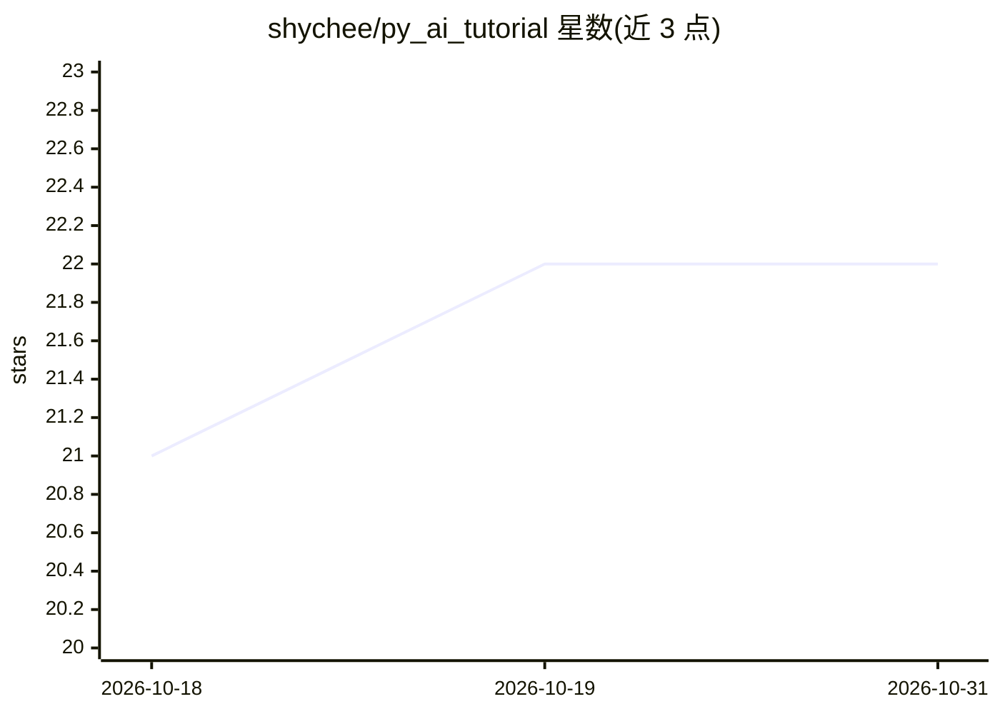

# shychee/py_ai_tutorial

⭐ 22 · Jupyter Notebook · 推送 2026-06-05 · [GitHub](https://github.com/shychee/py_ai_tutorial) · [官网](https://shychee.github.io/py_ai_tutorial/) · 个人维护 · 中文 README

**面向 Python 后端工程师的 AI 实战教程（ML→DL→LLM）**

为具备 3-5 年 Python 后端经验的工程师设计的渐进式学习教程，分三个阶段：传统机器学习与数据挖掘（scikit-learn/NumPy/Pandas）、深度学习（PyTorch/TensorFlow，CV/NLP）、AIGC 与大模型（LangChain/RAG/Agent/对话系统）。含 17 个行业项目作业，核心项目提供 PyTorch 与 TensorFlow 双框架实现，文档与注释以中文为主。使用 uv 包管理器与 pyproject.toml 配置，覆盖 macOS/Linux/Windows/云端 GPU 五类环境。

## 筛选速览

| 维度 | 判定 | 备注 |
|---|---|---|
| AI 角色 | `ai-knowledge` | 知识聚合/清单类 |
| 许可风险 | `none` | — |
| 部署形态 | `library` | 以包/库形式分发 |
| 模型依赖 | — | README 未给出锁定关系 |
| 硬件要求 | — | 无带数字的原话,不猜 |
| 安装摩擦 | `medium` | 含编译或系统依赖之一 |
| 成熟度 | — | 结构信号不足 |

## 能力要点

- 三阶段渐进路径：传统 ML → 深度学习 → 大模型应用
- 17 个行业项目作业，核心项目 PyTorch/TensorFlow 双实现
- 跨平台配置指引：macOS(MPS)/Linux(CUDA)/Windows/WSL2/云端 GPU
- uv 包管理器 + pyproject.toml 标准工具链

## 适用场景

- 后端工程师系统转行学习 AI 技术栈
- 按项目作业练习数据分析、CV、NLP 与 LLM 应用开发
- 在不同操作系统或云端 GPU 环境下配置开发环境

## 场景标签

`教程课程` · 领域:学习与行业

## 证据(README 行号)

> L19: > 为具备 3-5 年 Python 后端经验的工程师打造的 AI 学习路径，从传统机器学习到生成式 AI 的渐进式教程体系。
> L25: - **阶段3：机器学习与数据挖掘** - NumPy/Pandas数据分析 + scikit-learn传统ML
> L26: - **阶段4：深度学习** - PyTorch/TensorFlow深度学习 + CV/NLP应用
> L27: - **阶段5：AIGC与大模型** - LangChain/RAG/Agent + 对话系统开发

## 星数曲线

2026-10-18 21 → 2026-10-31 22（+1）

---
*卡片 v1 · prompt 1.4 · 生成 2026-10-27 · 置信度 mid · 依据 README sha `2c7518f063b0` · [字段定义](../../DATASET.md)*
