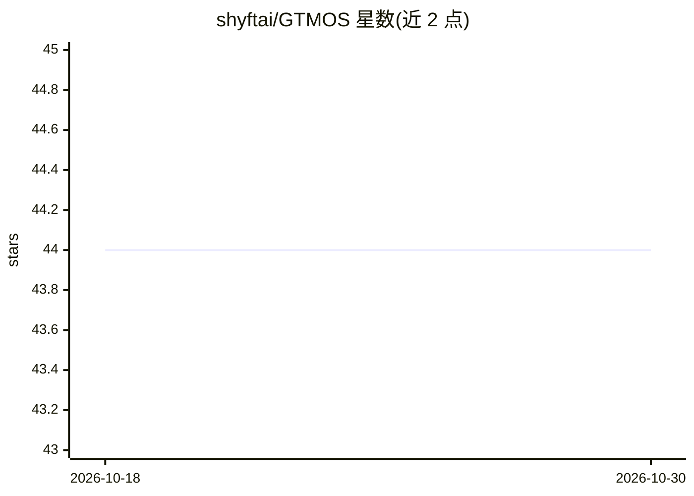

# shyftai/GTMOS

⭐ 44 · PLpgSQL · NOASSERTION · 推送 2026-06-17 · [GitHub](https://github.com/shyftai/GTMOS) · [官网](https://shyft.ai) · 组织维护

**面向 B2B 外联销售的 Claude Code 插件：从 ICP 到投放全流程**

运行于 Claude Code 内的 go-to-market 工作流插件：以斜杠命令覆盖 ICP 定义、列表构建与瀑布式补全、文案撰写（12 种语言）、投放前质量门检查（ICP/Persona/Briefing/TOV/Rules 五重校验）、回复处理、健康监控与报告。通过 MCP 服务器与 API key 接入 Apollo、Instantly、Attio 等 70+ 外联工具，全部可选；内置抑制名单、法规检测、同意追踪等合规辅助但不构成合规方案。面向 GTM 工程师、SDR、RevOps 团队与代理机构。

## 筛选速览

| 维度 | 判定 | 备注 |
|---|---|---|
| AI 角色 | `ai-native` | 本体是模型或模型工具 |
| 许可风险 | `none` | NOASSERTION |
| 部署形态 | `library` | 以包/库形式分发 |
| 模型依赖 | locked-api |  |
| 硬件要求 | — | 无带数字的原话,不猜 |
| 安装摩擦 | `low` | 无编译、无系统依赖或容器化 |
| 成熟度 | — | 结构信号不足 |

## 能力要点

- 斜杠命令覆盖 onboard→research→list→write→ship→manage→report 七阶段流程
- 五份真相文件（ICP/PERSONA/BRIEFING/TOV/RULES）做发布前质量门
- 通过 MCP 与 API key 接入 70+ 外联工具，逐工具可选
- 内置抑制名单、法规检测、同意追踪等合规辅助与审批门

## 适用场景

- 在 Claude Code 里从 ICP 定义到投放 B2B 冷邮件外联活动
- 对联系人列表做补全、打分与验证后再投放
- 分类处理回复并生成多语言触达文案

## 场景标签

`工作流自动化` `AI 写作` · 领域:效率与自动化

## 证据(README 行号)

> L3: > Turn Claude Code into a full outbound campaign engine. Brief it. Build it. Ship it. Measure it.
> L5: GTM:OS is a Claude Code plugin that runs your entire go-to-market workflow — from ICP definition to list building, c

## 星数曲线

2026-10-18 44 → 2026-10-30 44（+0）

---
*卡片 v1 · prompt 1.4 · 生成 2026-10-25 · 置信度 mid · 依据 README sha `6a3e3a46a4aa` · [字段定义](../../DATASET.md)*
