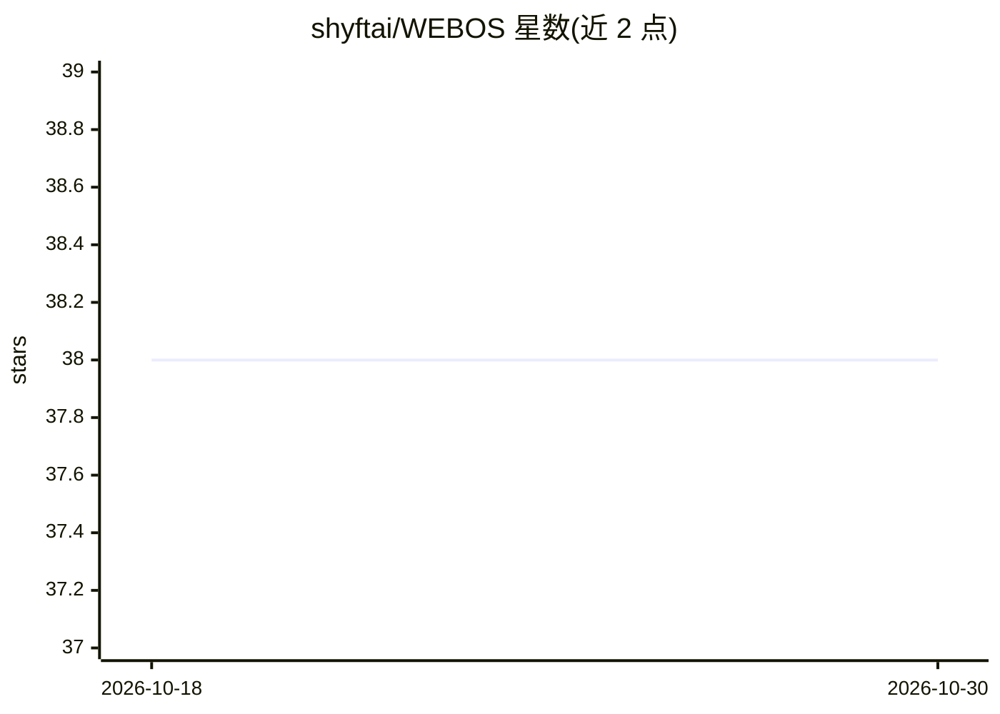

# shyftai/WEBOS

⭐ 38 · NOASSERTION · 推送 2026-03-27 · [GitHub](https://github.com/shyftai/WEBOS) · [官网](https://shyft.ai) · 组织维护

**把 Claude Code 变成网络内容运营系统的命令集与工作流**

基于 Claude Code 运行的内容运营工具：通过 git clone 仓库并用 Claude Code 打开即自动启动，提供 30 余个斜杠命令覆盖内容简报撰写、批量生成、SEO 审计、关键词聚类、发布到 CMS、转化优化、竞品监控与报告等环节。以 11 个 Markdown 工作区文档作为品牌与策略事实源，每篇内容过 8 道质量门检查，并有持续学习系统记录有效做法。支持 Solo/团队（Supabase）协作与 API 批量模式。

## 筛选速览

| 维度 | 判定 | 备注 |
|---|---|---|
| AI 角色 | `ai-ecosystem` | LLM/agent 周边工具 |
| 许可风险 | `none` | NOASSERTION |
| 部署形态 | `None` |  |
| 模型依赖 | locked-api |  |
| 硬件要求 | — | 无带数字的原话,不猜 |
| 安装摩擦 | `low` | 无编译、无系统依赖或容器化 |
| 成熟度 | — | 结构信号不足 |

## 能力要点

- 30 余个 /web: 命令覆盖研究、创作、SEO、发布、转化、度量全流程
- 11 个 Markdown 文档作为品牌/受众/策略的事实源，行动前必读
- 每篇内容发布前通过 8 道质量门检查
- 学习系统沉淀每篇内容的效果复盘，下次写作会话前加载

## 适用场景

- 内容团队统一管理品牌语气、受众与内容日历
- 自动化 SEO 审计、关键词聚类与既有内容优化
- 批量创作并通过质量门检查后发布到 CMS
- 机构多品牌组合的内容运营看板

## 场景标签

`工作流自动化` `AI 写作` · 领域:效率与自动化

## 证据(README 行号)

> L3: Turn Claude Code into a full web content operation. Write it. Publish it. Rank it. Convert it.
> L10: claude

## 星数曲线

2026-10-18 38 → 2026-10-30 38（+0）

---
*卡片 v1 · prompt 1.4 · 生成 2026-10-25 · 置信度 high · 依据 README sha `385920a38d2b` · [字段定义](../../DATASET.md)*
