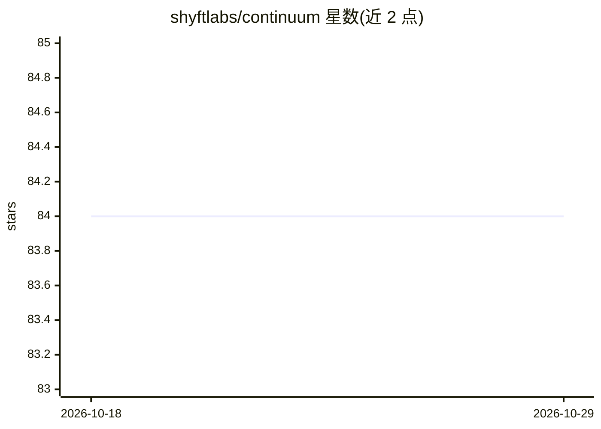

# shyftlabs/continuum

⭐ 84 · Python · Apache-2.0 · 推送 2026-10-07 · [GitHub](https://github.com/shyftlabs/continuum) · [官网](https://docs.continuum.shyftlabs.io/) · 组织维护

**面向开发者的企业级 AI agent 构建与编排运行时框架**

ShyftLabs 维护的 Python 框架（Apache-2.0），用于构建、编排和部署 AI agent：提供强类型 agent 核心与九种多 agent 模式、按请求复杂度分级的成本感知多模型路由与跨提供商故障转移、mem0+Qdrant/Milvus 长期记忆与 Redis 会话、MCP 协议工具调用、Temporal 持久化工作流（含 human-in-the-loop 审批）、Langfuse 追踪观测及 DeepEval/RAGAS 评测。要求 Python 3.13+ 与 Docker，通过 pip 安装并用 continuum up 命令启动本地基础设施（Redis/Qdrant 等容器），配置基于环境变量与 .env 文件。

## 筛选速览

| 维度 | 判定 | 备注 |
|---|---|---|
| AI 角色 | `ai-ecosystem` | LLM/agent 周边工具 |
| 许可风险 | `permissive` | Apache-2.0 |
| 部署形态 | `library` | 以包/库形式分发 |
| 模型依赖 | — | README 未给出锁定关系 |
| 硬件要求 | — | 无带数字的原话,不猜 |
| 安装摩擦 | `low` | 无编译、无系统依赖或容器化 |
| 成熟度 | — | 结构信号不足 |

## 能力要点

- 九种可组合多 agent 模式（顺序/并行/循环/路由/规划/反思/辩论/散射/监督）
- 成本感知多模型路由与跨提供商故障转移
- MCP 多传输协议工具调用与多 agent 交接（含历史摘要、环检测）
- Temporal 持久化工作流与 human-in-the-loop 审批门，Langfuse 全链路观测

## 适用场景

- 构建带长期记忆与结构化输出的生产级 AI agent
- 按成本在多个 LLM 提供商间路由请求并自动故障转移
- 编排多 agent 工作流并接入 MCP 工具生态
- 对 agent 运行做追踪、评测与回归测试

## 场景标签

`Agent 框架` `多智能体` · 领域:Agent 开发

## 证据(README 行号)

> L7: Build, run, and deploy reliable AI agents at enterprise scale — multi-LLM routing, persistent memory, MCP-native too
> L20: **Continuum** is a production-grade Python framework for building, orchestrating, and shipping autonomous AI agents
> L24: - 🤖 **Agentic core & orchestration** — a strongly-typed agent primitive with full lifecycle hooks, schema-validated

## 星数曲线

2026-10-18 84 → 2026-10-29 84（+0）

---
*卡片 v1 · prompt 1.4 · 生成 2026-10-24 · 置信度 high · 依据 README sha `273f32169335` · [字段定义](../../DATASET.md)*
