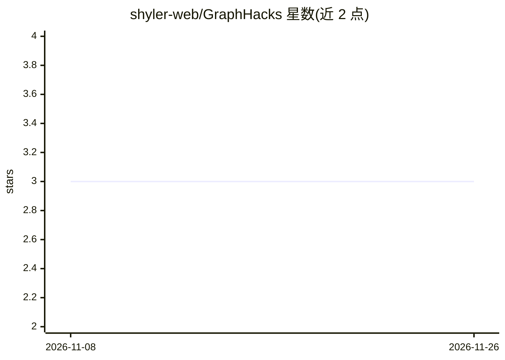

# shyler-web/GraphHacks

⭐ 3 · Python · 推送 2026-10-29 · [GitHub](https://github.com/shyler-web/GraphHacks) · 个人维护

**基于 FalkorDB 图数据库的多 Agent 记忆与工程协调驾驶舱**

为 WeMakeDevs × FalkorDB Graph Hacks 黑客松开发的多 Agent 工程驾驶舱，将 Agent 记忆与多视角技术信息统一存入 FalkorDB 图。核心机制：单一图按 L0–L5 六级成熟度读取、17 个领域透镜、4 个协作 Agent（VibeArchitect/FullStackBuilder/SeniorAuditor/LearningCoach），审计风险经 [:ENDANGERS] 边向上冒泡并可固化为 :Playbook 工作流。FalkorDB 是硬依赖，离线即停止工作；外部 LLM/搜索 API 未配置 key 时降级为确定性合成器或返回 503。提供 Docker Compose 与本地原生两种启动方式。

## 筛选速览

| 维度 | 判定 | 备注 |
|---|---|---|
| AI 角色 | `ai-native` | 本体是模型或模型工具 |
| 许可风险 | `none` | — |
| 部署形态 | `self-host` | docker 或自建部署 |
| 模型依赖 | — | README 未给出锁定关系 |
| 硬件要求 | — | 无带数字的原话,不猜 |
| 安装摩擦 | `low` | 无编译、无系统依赖或容器化 |
| 成熟度 | `idea` | |

## 能力要点

- 四级记忆图模型：情景/语义/程序/协调（Session、ConceptNode、Workflow、Handoff 等节点）
- Builder Maturity Dial：同一图按 L0–L6 六个角色深度读取
- Senior Auditor 风险经 [:ENDANGERS] 冒泡至 L0，修复保存为可回放的 :Playbook
- 支持加载任意 GitHub 仓库生成代码图（需可选 graphify CLI）

## 适用场景

- 让多个 AI Agent 共享持久化工程记忆与交接记录
- 初学者用 L0 卡片理解代码库，资深工程师看 L4–L5 复杂度分析
- 审计安全风险并在图中沉淀可复用的修复工作流

## 场景标签

`Agent 记忆` `多智能体` · 领域:Agent 开发

## 证据(README 行号)

> L24: GraphSync Nexus is a multi-agent engineering cockpit whose **memory and coordination layer is a real, load-bearing 
> L36: GraphSync Nexus unifies all technical perspectives and agent memories into **one connected FalkorDB graph**:
> L170: |`NEBIUS_API_KEY`|Live LLM agent squad synthesis & `/api/guidance`|Deterministic synthesizer used; guidance return

## 星数曲线

2026-11-08 3 → 2026-11-26 3（+0）

---
*卡片 v1 · prompt 1.4 · 生成 2026-11-21 · 置信度 high · 依据 README sha `fb580a067c41` · [字段定义](../../DATASET.md)*
