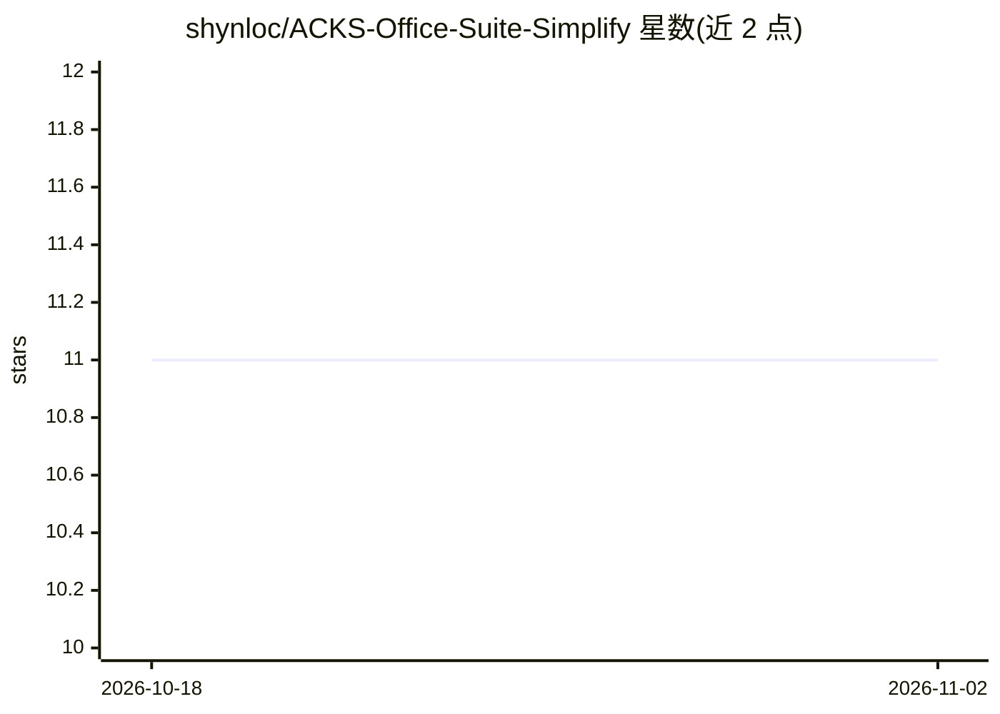

# shynloc/ACKS-Office-Suite-Simplify

⭐ 11 · Python · MIT · 推送 2026-10-10 · [GitHub](https://github.com/shynloc/ACKS-Office-Suite-Simplify) · [官网](https://pypi.org/project/acks-office/) · 组织维护 · 中文 README

**面向 AI Agent 与 Python 的四格式办公文档引擎（生成/读取/转换）**

ACKS Studio 出品的 Python 库（安装名 acks-office），按主题生成 Word / Excel / PPT / PDF，支持读取 docx/pdf/pptx/xlsx/xls、合并、水印与 PDF 按页拆分；生成与读取由 Python 完成，不需 Microsoft Office 或 WPS，格式转换委托 LibreOffice。提供 CLI 子命令（create/extract/convert/watermark/merge/theme/fonts/doctor）、只读环境检查 doctor 与供 Claude Code、Codex、OpenClaw 等 Agent 使用的技能包。主题是可自建的数据包，决定四格式共用的配色与版式；PDF 仅能嵌入 TrueType 字体，扫描件需外部 OCR。最低 Python 3.10。

## 筛选速览

| 维度 | 判定 | 备注 |
|---|---|---|
| AI 角色 | `ai-ecosystem` | LLM/agent 周边工具 |
| 许可风险 | `permissive` | MIT |
| 部署形态 | `library` | 以包/库形式分发 |
| 模型依赖 | — | README 未给出锁定关系 |
| 硬件要求 | — | 无带数字的原话,不猜 |
| 安装摩擦 | `low` | 无编译、无系统依赖或容器化 |
| 成熟度 | — | 结构信号不足 |

## 能力要点

- 主题驱动四格式统一版式，内置 neutral/slate/folio 三套主题并支持自建与校验
- 生成/读取不需 Microsoft Office 或 WPS；convert 命令委托 LibreOffice 转换
- doctor 只读环境检查（Python/依赖/字体/LibreOffice），给出补齐计划不自动安装
- Agent 技能包（SKILL.md + 脚本）兼容 Claude Code、Codex、OpenClaw 等

## 适用场景

- 让 Agent 或脚本批量生成带统一主题的 Word/PPT/PDF/Excel 文档
- 在无 Office 的服务器环境读取、合并、加水印办公文档
- 把 DOCX 等格式经 LibreOffice 做 CLI/API 转换

## 场景标签

`文档解析` · 领域:知识与检索

## 证据(README 行号)

> L5: > 面向 AI Agent 和 Python 程序的办公文档引擎：按主题生成 Word / Excel / PPT / PDF，读取、转换、加水印、合并，
> L61: 技能包由 `SKILL.md`、Python 入口脚本和程序代码组成，供支持技能规范及本地命令执行的 Agent 使用。

## 星数曲线

2026-10-18 11 → 2026-11-02 11（+0）

---
*卡片 v1 · prompt 1.4 · 生成 2026-11-01 · 置信度 high · 依据 README sha `52f464050e0c` · [字段定义](../../DATASET.md)*
