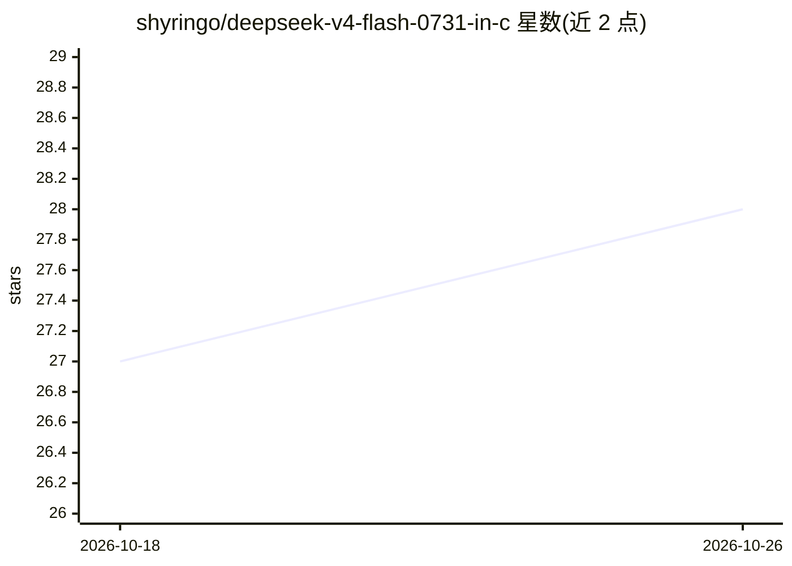

# shyringo/deepseek-v4-flash-0731-in-c

⭐ 28 · C · Apache-2.0 · 推送 2026-09-09 · [GitHub](https://github.com/shyringo/deepseek-v4-flash-0731-in-c) · [官网](https://shyringo.github.io/shyringo/) · 个人维护 · 中文 README

**纯 C99 实现：在笔记本单 CPU 上本地运行 DeepSeek-V4-Flash-0731**

以纯 C99 编写的本地 LLM/MoE 推理引擎，在单颗 64 位 CPU（x86-64/ARM64）上运行原生 DeepSeek-V4-Flash-0731（284B-A13B）checkpoint，最低 8 GB 内存、约 172 GB 磁盘，无需 GPU、CUDA、PyTorch 或权重转换。提供终端聊天与常驻的 OpenAI 兼容本地 API（支持 function tools 与流式 SSE），并实现逐层批处理、prompt-lookup 投机解码、双缓冲专家流式加载、LRU 专家缓存等优化。需从源码编译，参考环境（32 GB 笔记本）最优 TPOT 0.892 s/token。

## 筛选速览

| 维度 | 判定 | 备注 |
|---|---|---|
| AI 角色 | `ai-ecosystem` | LLM/agent 周边工具 |
| 许可风险 | `permissive` | Apache-2.0 |
| 部署形态 | `None` |  |
| 模型依赖 | locked-api |  |
| 硬件要求 | — | 无带数字的原话,不猜 |
| 安装摩擦 | `high` | 编译与系统依赖俱全 |
| 成熟度 | — | 结构信号不足 |

## 能力要点

- 纯 C99 MoE 推理引擎，无 GPU/CUDA/PyTorch/权重转换，最低 8 GB RAM
- 常驻 OpenAI 兼容本地 API，支持 function tools 与流式 SSE
- prompt-lookup 投机解码、双缓冲专家流式加载等十余项推理优化
- 含四层小模型正确性测试套件，与独立 Python 实现对齐

## 适用场景

- 在没有 GPU 的笔记本上本地运行 284B-A13B MoE 模型
- 为本地应用提供常驻 OpenAI 兼容 API 服务
- 研究 CPU 环境下 MoE 低比特推理优化技术

## 场景标签

 · 领域:LLM 推理基础设施

## 证据(README 行号)

> L5:  A pure C local LLM and MoE inference engine, written in portable C99, with no GPU, CUDA, PyTorch or weight conversi
> L4:  Chat in the terminal or connect apps through a resident local OpenAI-compatible API.

## 星数曲线

2026-10-18 27 → 2026-10-26 28（+1）

---
*卡片 v1 · prompt 1.4 · 生成 2026-10-26 · 置信度 high · 依据 README sha `8e036f187b2c` · [字段定义](../../DATASET.md)*
