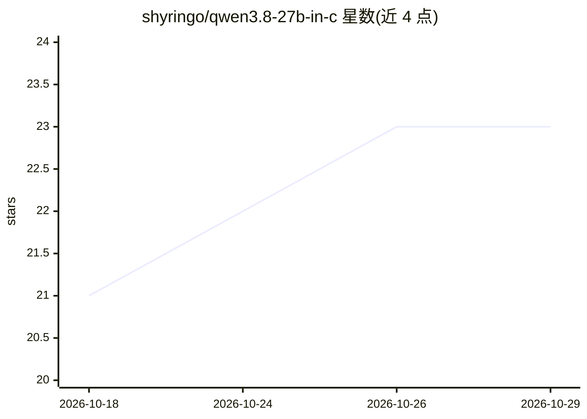

# shyringo/qwen3.8-27b-in-c

⭐ 23 · C · Apache-2.0 · 推送 2026-09-09 · [GitHub](https://github.com/shyringo/qwen3.8-27b-in-c) · [官网](https://shyringo.github.io/shyringo/) · 个人维护 · 中文 README

**纯 C 实现：在单颗笔记本 CPU 上运行 Qwen3.8-27B 对话**

针对 Qwen3.8-27B 的原生 C 推理引擎：不依赖 GPU、CUDA、Python、PyTorch 或外部推理运行时，在 64 位 POSIX 系统（Windows 需 WSL2）上从源码编译运行。启动脚本自动编译引擎并从 ModelScope 下载 GGUF 权重（IQ1_M 最低 8 GB 内存，Q4_K_M 需约 20 GiB），提供终端对话与本地 OpenAI 兼容 API（含函数工具、并行调用、SSE 流式）。优化路径与基线产出逐位一致的 logits，仅保留量化本身的有损性。当前仅支持文本，不接受图像与视频输入。

## 筛选速览

| 维度 | 判定 | 备注 |
|---|---|---|
| AI 角色 | `ai-native` | 本体是模型或模型工具 |
| 许可风险 | `permissive` | Apache-2.0 |
| 部署形态 | `None` |  |
| 模型依赖 | — | README 未给出锁定关系 |
| 硬件要求 | — | 无带数字的原话,不猜 |
| 安装摩擦 | `high` | 编译与系统依赖俱全 |
| 成熟度 | — | 结构信号不足 |

## 能力要点

- 单颗笔记本 CPU 运行 27B 模型，参考机最高 2.52 token/s，IQ1_M 路径最低 8 GB 内存
- 本地 OpenAI 兼容 API：函数工具、并行调用、工具结果回放、SSE 流式，无需 API key
- 优化与基线路径对同一 GGUF 产出 100% 逐位一致的 full logits
- 一条命令完成编译、权重下载校验与内存自适应模型选择

## 适用场景

- 在没有 GPU 的笔记本上本地运行 Qwen3.8-27B 进行对话
- 把本地 OpenAI 兼容端点接入现有客户端或函数工具应用
- 在 8 GB 内存的小内存机器上以 IQ1_M 量化运行大模型

## 场景标签

`推理引擎` · 领域:训练与推理

## 证据(README 行号)

> L5:  A native C inference engine with no GPU, CUDA, Python, PyTorch, model conversion, or external inference runtime.
> L208: - **Native resident chat and tool API.** A bounded C HTTP/JSON path keeps the

## 星数曲线

2026-10-18 21 → 2026-10-29 23（+2）

---
*卡片 v1 · prompt 1.4 · 生成 2026-10-27 · 置信度 high · 依据 README sha `01fb05361e1a` · [字段定义](../../DATASET.md)*
