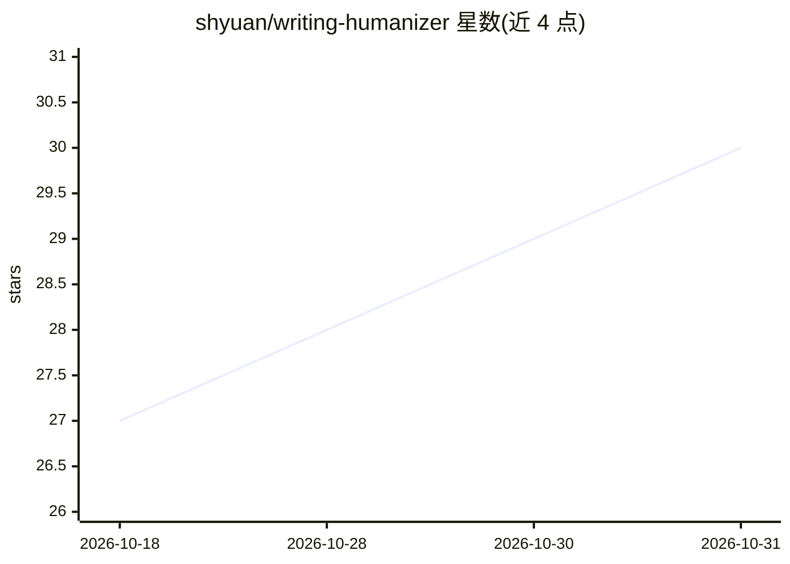

# shyuan/writing-humanizer

⭐ 30 · JavaScript · MIT · 推送 2026-06-21 · [GitHub](https://github.com/shyuan/writing-humanizer) · 个人维护 · 中文 README

**去除中文文章 AI 寫作痕跡的 agent skill，供七種 CLI host 使用**

單一 `writing-humanizer` skill，可偵測並改寫 31 類 AI 寫作模式，涵蓋內容誇大、AI 詞彙過用、破折號與粗體濫用、聊天機器人痕跡、以及中文論說文專屬的結構修辭模式。針對台灣正體中文提供詞彙警示列表與替代建議，採兩輪改寫流程（初稿加自我審查），並附 5 維度滿分 50 分的質量評分系統。同一 skill 可在 Claude Code、OpenAI Codex、Cursor、Google Antigravity CLI、OpenCode、Kimi CLI 與 pi 七種 host 上運行，各 host 讀取各自的 manifest。

## 筛选速览

| 维度 | 判定 | 备注 |
|---|---|---|
| AI 角色 | `ai-native` | 本体是模型或模型工具 |
| 许可风险 | `permissive` | MIT |
| 部署形态 | `None` |  |
| 模型依赖 | — | README 未给出锁定关系 |
| 硬件要求 | — | 无带数字的原话,不猜 |
| 安装摩擦 | `low` | 无编译、无系统依赖或容器化 |
| 成熟度 | — | 结构信号不足 |

## 能力要点

- 偵測並改寫 31 類 AI 寫作模式，含中文論說文專屬結構修辭（25-31 類）
- 台灣正體中文 AI 詞彙警示列表與替代建議
- 兩輪改寫流程（初稿 + 自我審查再修改）與 5 維度 50 分制質量評分
- 一份 skill 支援七種 host（Claude Code、Codex、Cursor、Antigravity CLI、OpenCode、Kimi CLI、pi）

## 适用场景

- 把 AI 生成的中文文章改寫得更自然、減少機器感
- 交付前檢查並消除 AI 寫作模式以利發布
- 在 Claude Code 等 CLI 環境中即時呼叫 skill 處理文稿

## 场景标签

`AI 写作` · 领域:内容生成

## 证据(README 行号)

> L3: Remove AI writing patterns from text, making it sound more natural and human. Focused on Traditional Chinese (Taiwan
> L59: A comprehensive skill that detects and rewrites 31 categories of AI writing patterns:
> L86: - Two-pass rewriting process with self-audit

## 星数曲线

2026-10-18 27 → 2026-10-31 30（+3）

---
*卡片 v1 · prompt 1.4 · 生成 2026-10-26 · 置信度 high · 依据 README sha `4609cd5cfa2e` · [字段定义](../../DATASET.md)*
