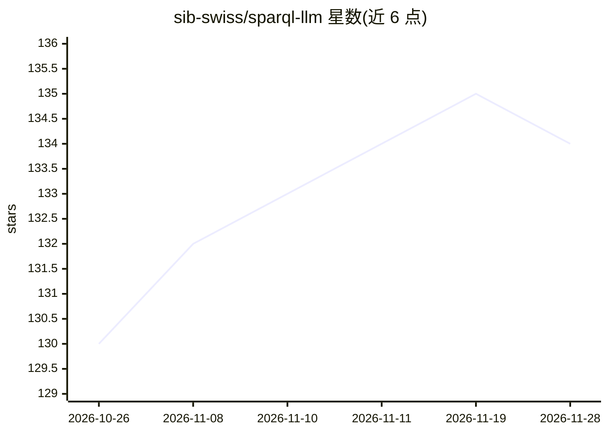

# sib-swiss/sparql-llm

⭐ 134 · Jupyter Notebook · MIT · 推送 2026-11-27 · [GitHub](https://github.com/sib-swiss/sparql-llm) · [官网](https://chat.expasy.org) · 组织维护

**帮助 LLM 生成 SPARQL 查询的聊天服务、MCP server 与 Python 组件库**

SIB（瑞士生物信息学研究所）维护的项目，提供三部分：部署于 expasy.org/chat 的聊天 Web 服务、暴露检索与执行工具的 MCP server、以及 pip 包 sparql-llm 的可复用组件。机制上结合 RAG（从 SPARQL endpoint 提取查询示例与类 schema 作为检索元数据）与基于 VoID 描述的 SPARQL 查询校验。要求目标 endpoint 内嵌 VoID 元数据（可用 void-generator 自动生成），主要面向 SIB 旗下 UniProt、Bgee、OMA 等生物数据资源。

## 筛选速览

| 维度 | 判定 | 备注 |
|---|---|---|
| AI 角色 | `ai-ecosystem` | LLM/agent 周边工具 |
| 许可风险 | `permissive` | MIT |
| 部署形态 | `self-host` | docker 或自建部署 |
| 模型依赖 | — | README 未给出锁定关系 |
| 硬件要求 | — | 无带数字的原话,不猜 |
| 安装摩擦 | `low` | 无编译、无系统依赖或容器化 |
| 成熟度 | — | 结构信号不足 |

## 能力要点

- 提供 MCP server，含文档检索、类 schema 检索与 SPARQL 查询执行工具
- pip 包提供 LangChain 兼容的元数据 loader 与联邦 SPARQL 查询校验函数
- 容器化的聊天系统部署方案（Web UI + API + 内嵌向量库）
- 多个 UniProt/Bgee/Rhea 等生物数据的交互式 widget 工具

## 适用场景

- 为机构的一组 SPARQL endpoint 部署自然语言查询聊天服务
- 让支持 MCP 的客户端（如 VSCode）通过工具检索并执行 SPARQL 查询
- 在自己的 RAG 管线中复用 endpoint 元数据 loader 与查询校验函数

## 场景标签

`RAG` `聊天机器人` · 领域:对话与助手

## 证据(README 行号)

> L7: This project provides tools to enhance the capabilities of Large Language Models (LLMs) in generating SPARQL queries
> L30: - **MCP server** with tools to help LLM write SPARQL queries for a set of endpoints
> L149: pip install sparql-llm

## 星数曲线

2026-10-26 130 → 2026-11-28 134（+4）

---
*卡片 v1 · prompt 1.4 · 生成 2026-11-28 · 置信度 high · 依据 README sha `a1d40fba3126` · [字段定义](../../DATASET.md)*
