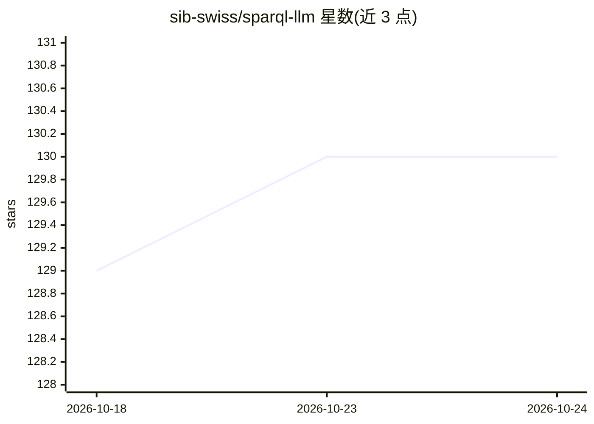

# sib-swiss/sparql-llm

⭐ 130 · Jupyter Notebook · MIT · 推送 2026-10-24 · [GitHub](https://github.com/sib-swiss/sparql-llm) · [官网](https://chat.expasy.org) · 组织维护

**帮 LLM 生成 SPARQL 查询的 MCP 服务器、聊天系统与组件**

由 SIB（瑞士生物信息学研究所）维护的项目，提供三部分：部署在 expasy.org/chat 的聊天 Web 服务、部署在 chat.expasy.org/mcp 的 MCP 服务器，以及 pip 包 sparql-llm 形式的可复用组件。系统结合 RAG 与基于 VoID 端点元数据的 SPARQL 查询校验，提升 LLM 生成查询的准确性；MCP 服务器暴露文档检索、类结构检索、查询执行等工具，并提供 UniProt、Bgee、Rhea 等 SIB 生物数据资源的交互式 widget 工具。要求端点包含 SPARQL 查询示例与 VoID 描述等元数据。

## 筛选速览

| 维度 | 判定 | 备注 |
|---|---|---|
| AI 角色 | `ai-ecosystem` | LLM/agent 周边工具 |
| 许可风险 | `permissive` | MIT |
| 部署形态 | `self-host` | docker 或自建部署 |
| 模型依赖 | — | README 未给出锁定关系 |
| 硬件要求 | — | 无带数字的原话,不猜 |
| 安装摩擦 | `low` | 无编译、无系统依赖或容器化 |
| 成熟度 | — | 结构信号不足 |

## 能力要点

- MCP 服务器提供文档/类结构检索与 SPARQL 查询执行工具
- RAG 结合 VoID 元数据校验生成的 SPARQL 查询
- pip 安装的可复用组件（示例加载器、校验函数），兼容 LangChain 也可独立使用
- 面向 UniProt、Bgee、OMA 等 SIB 生物数据资源的一组交互式 widget 工具

## 适用场景

- 在 VSCode 等 MCP 客户端中通过自然语言查询 SPARQL 端点数据
- 为自有 SPARQL 端点部署 LLM 聊天式查询生成服务
- 在自有 LLM 应用中复用元数据加载与查询校验组件

## 场景标签

`RAG` `数据分析` · 领域:效率与自动化

## 证据(README 行号)

> L7: This project provides tools to enhance the capabilities of Large Language Models (LLMs) in generating SPARQL queries
> L10: - a **MCP server** exposing tools at **chat.expasy.org/mcp**
> L30: - **MCP server** with tools to help LLM write SPARQL queries for a set of endpoints

## 星数曲线

2026-10-18 129 → 2026-10-24 130（+1）

---
*卡片 v1 · prompt 1.4 · 生成 2026-10-23 · 置信度 mid · 依据 README sha `8e24dce957f6` · [字段定义](../../DATASET.md)*
