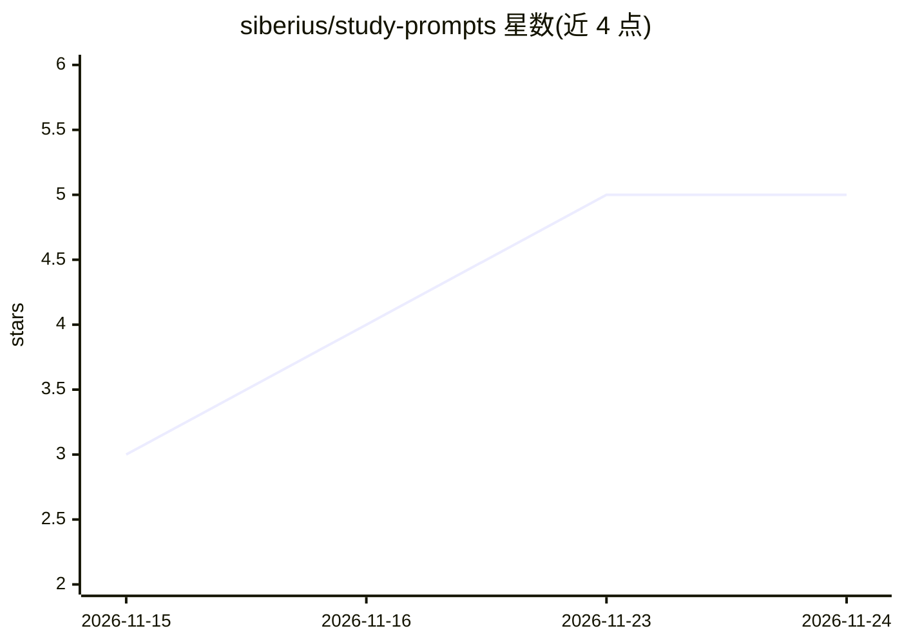

# siberius/study-prompts

⭐ 5 · CC0-1.0 · 推送 2026-11-11 · [GitHub](https://github.com/siberius/study-prompts) · [官网](https://vibemaker.cz/clanek/master-prompt-gemini-notebook/) · 个人维护

**面向教师与学生的源文本学习提示词库**

提示词库：一个主提示词加 15 个可选择的模式块，覆盖学习规划、讲解、检索、讲师侧重、测评与跨会话连续性。使用方式为提供学习材料后按顺序粘贴主提示词与所选模式块，续接会话时提供主提示词、材料与上次交接内容。为纯提示词文件集合，不安装 agent 技能或自动激活工具；引用、附件与上下文保持取决于宿主平台。官方维护英语版，捷克语、俄语、西班牙语版保持同一工作流，CC0 许可。未进行实机提供商测试或教育效果研究。

## 筛选速览

| 维度 | 判定 | 备注 |
|---|---|---|
| AI 角色 | `ai-knowledge` | 知识聚合/清单类 |
| 许可风险 | `viral` | CC0-1.0 |
| 部署形态 | `None` |  |
| 模型依赖 | — | README 未给出锁定关系 |
| 硬件要求 | — | 无带数字的原话,不猜 |
| 安装摩擦 | `low` | 无编译、无系统依赖或容器化 |
| 成熟度 | — | 结构信号不足 |

## 能力要点

- 1 个主提示词 + 15 个可选学习模式块（规划/讲解/检索/测评/连续性）
- 英语为主维护版，另有捷克语、俄语、西班牙语版本
- CC0 1.0 公共领域许可，纯提示词文件库，无需安装

## 适用场景

- 把自己的学习材料导入 Gemini Notebook 进行结构化学习
- 在 ChatGPT 或 Claude 等助手中共用同一套学习工作流
- 通过 handoff 机制在新会话中继续之前的学习进度

## 场景标签

`提示工程` · 领域:Agent 开发

## 证据(README 行号)

> L9: A source-based study prompt library: one shared master prompt and fifteen selectable blocks for planning, explanatio
> L28: Intended for Gemini Notebook and adaptable to ChatGPT, Claude, Gemini and other text assistants with access to your

## 星数曲线

2026-11-15 3 → 2026-11-24 5（+2）

---
*卡片 v1 · prompt 1.4 · 生成 2026-11-21 · 置信度 high · 依据 README sha `329889e08496` · [字段定义](../../DATASET.md)*
