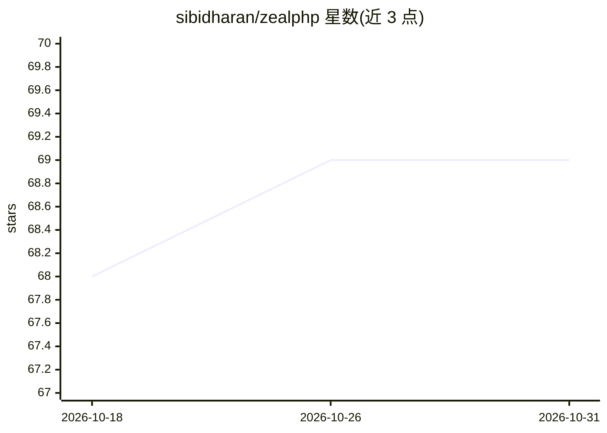

# sibidharan/zealphp

⭐ 69 · PHP · MIT · 推送 2026-10-24 · [GitHub](https://github.com/sibidharan/zealphp) · [官网](https://php.zeal.ninja) · 个人维护

**基于 OpenSwoole 的 PHP HTTP 服务器框架：常驻进程内跑传统 PHP 并获得异步能力**

ZealPHP 是构建在 OpenSwoole 之上的 PHP 应用服务器与框架：PHP 进程本身即 HTTP 服务器，常驻运行，内建 WebSocket、SSE、协程、共享内存、定时器与任务工作进程。核心机制是 ext-zealphp 扩展覆盖 session/header/超全局变量等函数，使传统请求式 PHP 在协程并发下不改代码运行；类图需在并发前预热，无自动加载器的应用走 legacy-cgi 子进程模式。提供 30+ PSR-15 中间件、可插拔 Store/Counter 后端（Redis/Valkey）、跨节点发布订阅与文件式 REST API。自述处于 Active alpha（v0.4.x），API 在 v1.0 前可能变化。

## 筛选速览

| 维度 | 判定 | 备注 |
|---|---|---|
| AI 角色 | `ai-enhanced` | 去掉 AI 部分产品仍成立 |
| 许可风险 | `permissive` | MIT |
| 部署形态 | `self-host` | docker 或自建部署 |
| 模型依赖 | — | README 未给出锁定关系 |
| 硬件要求 | — | 无带数字的原话,不猜 |
| 安装摩擦 | `low` | 无编译、无系统依赖或容器化 |
| 成熟度 | `idea` | |

## 能力要点

- coroutine-legacy 兼容运行时：传统 PHP 代码在协程并发下运行，超全局变量按协程隔离
- 内建 WebSocket、SSE、共享内存 Store/Counter、定时器与跨节点发布订阅
- 30+ PSR-15 中间件，覆盖常见 Apache mod_rewrite/nginx 配置模式
- 可插拔存储后端：一行配置切换到 Redis/Valkey 实现跨节点共享状态

## 适用场景

- 把已有 PHP 应用迁移到常驻异步运行时，获得 WebSocket/SSE 能力
- 在单个 PHP 应用内实现实时功能，不引入 Node.js/Go 边车服务
- 多人实时应用（如带房间与观战的联机游戏）的原型开发

## 场景标签

 · 领域:Web 开发/PHP 框架

## 证据(README 行号)

> L3: ZealPHP runs PHP as the HTTP server itself — not a CGI worker behind one. Built on **OpenSwoole**, it ships HTTP, We
> L62: PHP powers ~71% of the web (W3Techs), but the default request-per-process model (PHP-FPM, mod_php) keeps the interp

## 星数曲线

2026-10-18 68 → 2026-10-31 69（+1）

---
*卡片 v1 · prompt 1.4 · 生成 2026-10-24 · 置信度 low · 依据 README sha `69fbff7a26a8` · [字段定义](../../DATASET.md)*
