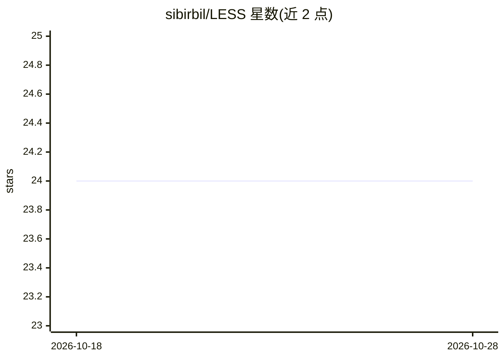

# sibirbil/LESS

⭐ 24 · Python · MIT · 推送 2026-10-03 · [GitHub](https://github.com/sibirbil/LESS) · [官网](https://less.readthedocs.io/en/latest/getting_started.html) · 个人维护

**监督学习算法 LESS：子集局部估计器堆叠的全局预测**

LESS 是一种监督学习算法：在数据集的多个子集上训练局部估计器，再将局部预测传递给全局估计器完成回归或分类。默认采用欧氏距离结合 RBF 核，README 提示训练前对输入特征做缩放或归一化。以 Python 包形式发布于 PyPI（pip install less-learn），API 遵循 scikit-learn 风格，提供基于 make_regression 的使用示例，并附论文引用信息。

## 筛选速览

| 维度 | 判定 | 备注 |
|---|---|---|
| AI 角色 | `ai-native` | 本体是模型或模型工具 |
| 许可风险 | `permissive` | MIT |
| 部署形态 | `library` | 以包/库形式分发 |
| 模型依赖 | — | README 未给出锁定关系 |
| 硬件要求 | — | 无带数字的原话,不猜 |
| 安装摩擦 | `low` | 无编译、无系统依赖或容器化 |
| 成熟度 | — | 结构信号不足 |

## 能力要点

- 在数据子集上训练多个局部估计器，预测传递给全局估计器
- 支持回归与分类任务
- 默认使用欧氏距离 + RBF 核，建议预先缩放/归一化特征

## 适用场景

- 作为 scikit-learn 风格估计器用于回归/分类建模
- 研究人员复现或引用 LESS 方法（附 BibTeX 引用）

## 场景标签

 · 领域:机器学习算法/库

## 证据(README 行号)

> L3: LESS is a supervised learning algorithm that is based on training many local estimators on subsets of a given datase

## 星数曲线

2026-10-18 24 → 2026-10-28 24（+0）

---
*卡片 v1 · prompt 1.4 · 生成 2026-10-27 · 置信度 high · 依据 README sha `99d74fd09161` · [字段定义](../../DATASET.md)*
