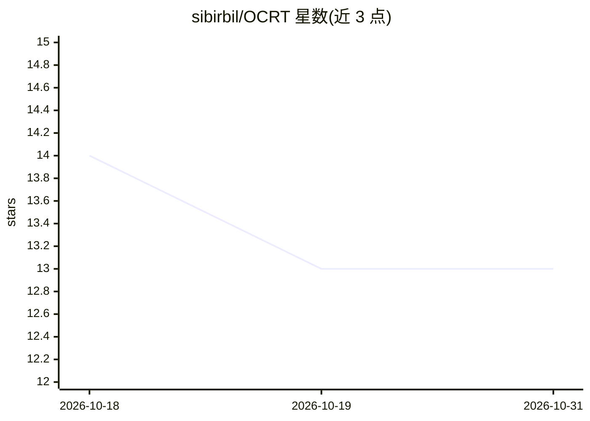

# sibirbil/OCRT

⭐ 13 · Python · 推送 2026-09-14 · [GitHub](https://github.com/sibirbil/OCRT) · 组织维护

**输出约束回归树：约束多目标回归的决策树训练方法**

论文配套代码库，实现三种带输出约束的回归树训练方法：M-OCRT（基于分裂的混合整数规划施加约束）、E-OCRT（穷举搜索最优分裂并在各决策节点求解约束预测）、EP-OCRT（对树预测做事后约束优化），并提供凸可行集下的随机森林框架。数据为合成数据集（由脚本生成）与层级时间序列数据集，存放于 data 文件夹。安装方式为 conda 环境文件 ocdt.yml，仓库当前支持训练 OCDT 模型并复现论文实验，参数涵盖分裂样本数、深度、评估指标（mse/mad/poisson）与预测方法（mean/medoid/optimal）。

## 筛选速览

| 维度 | 判定 | 备注 |
|---|---|---|
| AI 角色 | `ai-native` | 本体是模型或模型工具 |
| 许可风险 | `none` | — |
| 部署形态 | `None` |  |
| 模型依赖 | — | README 未给出锁定关系 |
| 硬件要求 | — | 无带数字的原话,不猜 |
| 安装摩擦 | `low` | 无编译、无系统依赖或容器化 |
| 成熟度 | — | 结构信号不足 |

## 能力要点

- 三种输出约束回归树方法（M-OCRT/E-OCRT/EP-OCRT）
- 凸可行集下的随机森林框架
- 支持 mse/mad/poisson 分裂评估与 mean/medoid/optimal 预测方法
- 附合成与层级时间序列数据集，可复现论文实验

## 适用场景

- 在约束多目标回归任务中训练可行预测模型
- 复现论文中的合成与工业层级时间序列实验
- 构建带凸可行集约束的随机森林集成

## 场景标签

`模型训练` · 领域:训练与推理

## 证据(README 行号)

> L5: Incorporating domain-specific constraints into machine learning models is essential for generating predictions that 
> L29: Currently, the repository is available for training the OCDT model.

## 星数曲线

2026-10-18 14 → 2026-10-31 13（-1）

---
*卡片 v1 · prompt 1.4 · 生成 2026-10-31 · 置信度 high · 依据 README sha `23eb84b3cea7` · [字段定义](../../DATASET.md)*
