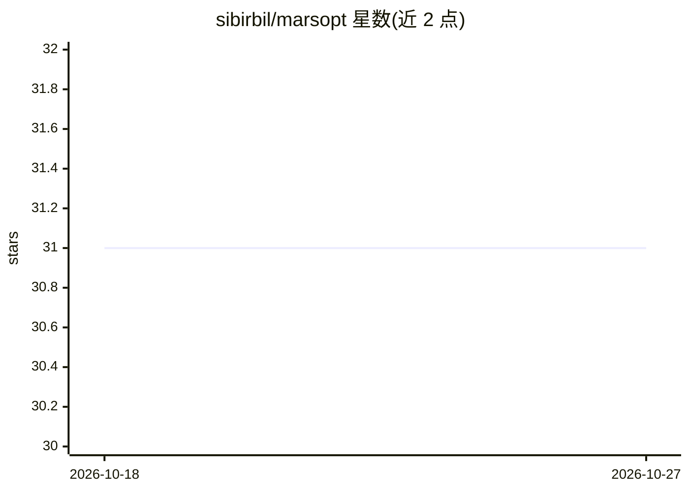

# sibirbil/marsopt

⭐ 31 · Cython · MIT · 推送 2026-05-22 · [GitHub](https://github.com/sibirbil/marsopt) · [官网](https://marsopt.readthedocs.io/en/latest/) · 个人维护

**混合自适应随机搜索（MARS）黑盒与超参数优化 Python 库**

基于 Mixed Adaptive Random Search (MARS) 算法的 Python 优化库，面向需要调优机器学习超参数或一般黑盒目标函数的用户。支持连续、整数、类别型变量混合搜索空间，可选 log-scale；机制包括自适应噪声采样（内置 cosine annealing 调度）、精英选择引导搜索、目标函数最小化/最大化。Study 支持随时续跑追加试验，可查看每次试验的目标值、参数与耗时。从 PyPI 以 pip 安装，MIT 许可。

## 筛选速览

| 维度 | 判定 | 备注 |
|---|---|---|
| AI 角色 | `ai-ecosystem` | LLM/agent 周边工具 |
| 许可风险 | `permissive` | MIT |
| 部署形态 | `library` | 以包/库形式分发 |
| 模型依赖 | — | README 未给出锁定关系 |
| 硬件要求 | — | 无带数字的原话,不猜 |
| 安装摩擦 | `low` | 无编译、无系统依赖或容器化 |
| 成熟度 | — | 结构信号不足 |

## 能力要点

- 连续/整数/类别变量混合搜索空间，支持 log-scale
- 自适应噪声采样与精英选择，内置 cosine annealing 调度
- Study 可中断后续跑，保留历史试验信息
- 支持任意自定义目标函数的最小化或最大化

## 适用场景

- 机器学习模型超参数调优
- 含类别与整数变量的黑盒目标函数优化
- 需要中途暂停并继续的长时间优化任务

## 场景标签

`MLOps` · 领域:训练与推理

## 证据(README 行号)

> L10: `marsopt` is a Python library designed to simplify and accelerate hyperparameter and black-box optimization. It sup
> L34: Below is a simplified example of how to use `marsopt` to tune a few common hyperparameters:

## 星数曲线

2026-10-18 31 → 2026-10-27 31（+0）

---
*卡片 v1 · prompt 1.4 · 生成 2026-10-26 · 置信度 high · 依据 README sha `6cbcdae3a8fa` · [字段定义](../../DATASET.md)*
