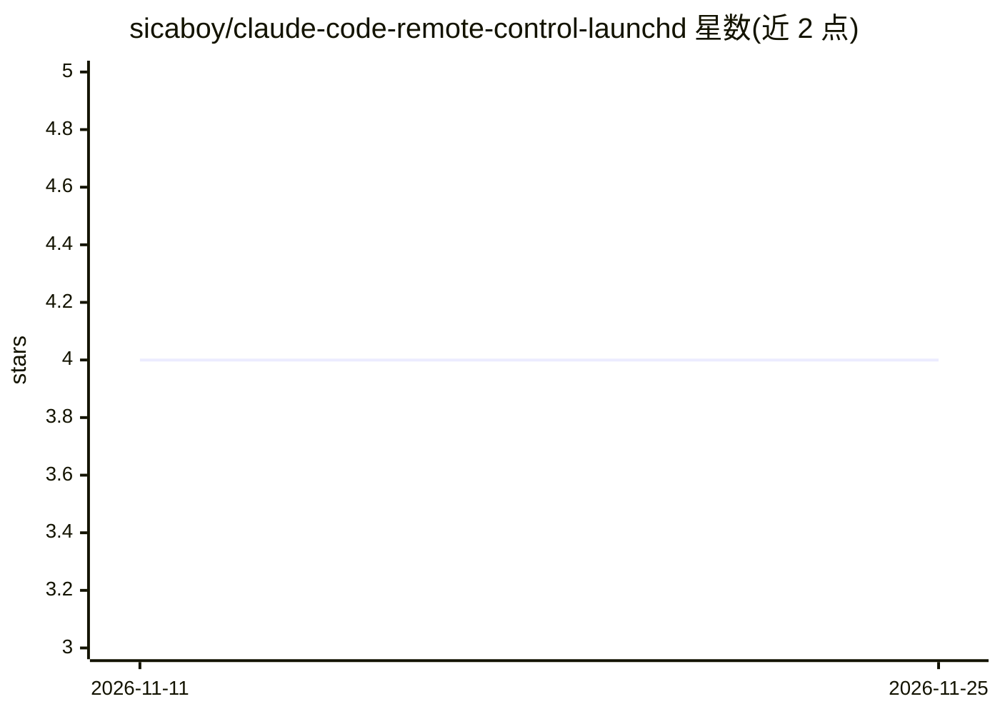

# sicaboy/claude-code-remote-control-launchd

⭐ 4 · Shell · MIT · 推送 2026-11-10 · [GitHub](https://github.com/sicaboy/claude-code-remote-control-launchd) · 个人维护 · 中文 README

**把 Claude Code 远程控制常驻为 macOS launchd 后台服务**

非官方社区项目：通过 launchd LaunchAgent 与一个监督脚本，把 `claude remote-control` 以登录自启、崩溃自动重启、限流防抖的方式常驻运行，使 Mac 在 Claude 应用的 Code 标签页显示为设备卡，可从手机开启独立会话。提供一键 curl 安装与卸载脚本、状态查看、心跳与退出日志。前置条件：已用 claude.ai 账号登录（API key 不支持）、工作目录需被信任；仅支持 macOS，依赖当前 Claude Code 版本的命令行为。

## 筛选速览

| 维度 | 判定 | 备注 |
|---|---|---|
| AI 角色 | `ai-ecosystem` | LLM/agent 周边工具 |
| 许可风险 | `permissive` | MIT |
| 部署形态 | `None` |  |
| 模型依赖 | — | README 未给出锁定关系 |
| 硬件要求 | — | 无带数字的原话,不猜 |
| 安装摩擦 | `low` | 无编译、无系统依赖或容器化 |
| 成熟度 | — | 结构信号不足 |

## 能力要点

- 一键 curl 或 clone 安装/卸载 LaunchAgent
- 登录自启、退出自动重启，3 次/小时启动退避防抖
- 可配置并发会话容量、工作目录、caffeinate 保持唤醒
- 清除继承的 CLAUDE*/ANTHROPIC 环境变量避免身份串用

## 适用场景

- 在手机上随时为家里的 Mac 启动新的编码会话
- 不想长期开着终端但需要远程控制服务常驻
- 管理 Mac 上 Claude Code 远程会话的容量与日志

## 场景标签

`编码 Agent` · 领域:编码与开发

## 证据(README 行号)

> L14: Run Claude Code **Remote Control** (`claude remote-control`) as an always-on macOS background service (launchd Laun
> L16: It is a small LaunchAgent plus a supervisor script. It starts at login, restarts the server when it exits, and refu
> L70: 4. runs `claude remote-control --spawn <mode> --capacity <n> --name <name>` in your work directory;

## 星数曲线

2026-11-11 4 → 2026-11-25 4（+0）

---
*卡片 v1 · prompt 1.4 · 生成 2026-11-21 · 置信度 high · 依据 README sha `540fda39332c` · [字段定义](../../DATASET.md)*
