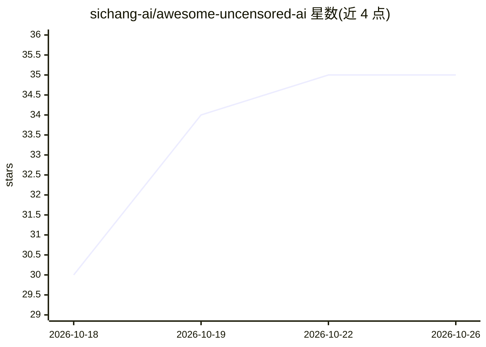

# sichang-ai/awesome-uncensored-ai

⭐ 35 · CC-BY-SA-4.0 · 推送 2026-10-15 · [GitHub](https://github.com/sichang-ai/awesome-uncensored-ai) · [官网](https://sichang.xyz) · 组织维护 · 中文 README

**中文视角的无审查 AI 平台横评与本地部署指南清单**

由思畅 AI 团队维护的中文策展清单：横评 AI 角色扮演与对话平台（思畅、Character AI、Chai、Kindroid 等）、图像/视频生成方案（云服务与本地权重），并梳理无审查模型的技术路线（abliteration/Heretic/微调）、本地部署路径、各平台内容红线与中外监管收紧动态。条目以表格呈现中文界面、成人内容政策、价格、数据训练用途等维度，未核实处明确标注。声明利益相关（思畅为列表内平台之一），不收录越狱提示词。

## 筛选速览

| 维度 | 判定 | 备注 |
|---|---|---|
| AI 角色 | `ai-knowledge` | 知识聚合/清单类 |
| 许可风险 | `viral` | CC-BY-SA-4.0 |
| 部署形态 | `None` |  |
| 模型依赖 | — | README 未给出锁定关系 |
| 硬件要求 | — | 无带数字的原话,不猜 |
| 安装摩擦 | `low` | 无编译、无系统依赖或容器化 |
| 成熟度 | — | 结构信号不足 |

## 能力要点

- 覆盖对话/角色扮演、图像、视频生成的多平台横评表格
- 无审查模型三路线（现成下载/Heretic 自动消融/在线平台）与代价说明
- 中外监管反向收紧对照整理（年龄核验、中国《暂行办法》条款）
- 未核实条目明确标注，事实附官方来源

## 适用场景

- 挑选内容政策宽松的 AI 对话或角色扮演平台
- 了解 abliteration/Heretic 等无审查模型处理方法与硬件门槛
- 对比图像/视频生成的云服务与本地部署方案及显存需求

## 场景标签

`精选清单` · 领域:学习与行业

## 证据(README 行号)

> L1: # 无审查 AI 平台大全
> L3: > 中文视角的全品类横评：AI 角色扮演、无限制 AI 对话、图像 / 视频 / 语音生成，以及本地部署方案。
> L10: 本仓库由**思畅 AI 团队**维护（sichang.xyz）。思畅是本列表中的一个平台，我们有明确的利益相关——因此我们的做法是：**竞品的优点照写，思畅的短板也写**，所有事实给出可核查的官方来源。发现不实或过时之处，欢迎提 

## 星数曲线

2026-10-18 30 → 2026-10-26 35（+5）

---
*卡片 v1 · prompt 1.4 · 生成 2026-10-25 · 置信度 high · 依据 README sha `3cdccb95328b` · [字段定义](../../DATASET.md)*
