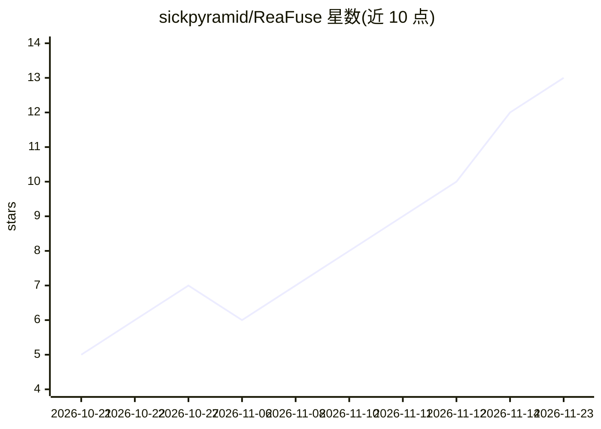

# sickpyramid/ReaFuse

⭐ 13 · JavaScript · MIT · 推送 2026-10-15 · [GitHub](https://github.com/sickpyramid/ReaFuse) · 个人维护

**基于 REA 的 CLI：拆解两个项目并融合生成一个新项目**

ReaFuse 是构建在 REA（Reverse Engineer Anything）之上的 Node.js CLI 工具：输入两个应用名、网站或仓库，先用 REA 静态分析产出行为规格卡，再由 AI 提出 3 个融合方案供用户选择，随后按预先编写的验收测试从零生成新代码库，在沙箱中运行测试并做代码原创性指纹扫描（检出复制则判定 REJECTED），输出 REPORT.md 与 SHA-256 证书。可通过 Claude Code/Codex/Cursor 等 MCP 客户端接入，也提供本地 Web lab 与 Docker 自托管。

## 筛选速览

| 维度 | 判定 | 备注 |
|---|---|---|
| AI 角色 | `ai-native` | 本体是模型或模型工具 |
| 许可风险 | `permissive` | MIT |
| 部署形态 | `self-host` | docker 或自建部署 |
| 模型依赖 | locked-api |  |
| 硬件要求 | — | 无带数字的原话,不猜 |
| 安装摩擦 | `low` | 无编译、无系统依赖或容器化 |
| 成熟度 | — | 结构信号不足 |

## 能力要点

- find→dissect→fuse→contract→grow→verify→originality→report 的八步流水线
- 测试先行的契约机制与沙箱验证（最多两轮修复）
- 代码原创性指纹扫描，检出复制即 REJECTED
- 内置 MCP server，支持 Claude Code/Codex/Cursor 等 agent 接入

## 适用场景

- 想基于两个现有项目的能力创造一个新的开源小工具
- 在 agent 中通过 MCP 调用让 AI 自动完成融合开发
- 需要带测试与原创性报告的可审计生成流程

## 场景标签

`代码生成` · 领域:编码与开发

## 证据(README 行号)

> L7: Name two apps or repos, for example `Spotify` and `WhatsApp`. ReaFuse studies both with REA, invents three new proje
> L138: 3. **Fuse:** the brain proposes three new projects that use both donors and add something neither had. You pick on
> L140: 5. **Grow:** a new codebase is written from the specs, with zero dependencies, its own tests, a README and a CLI.

## 星数曲线

2026-10-21 5 → 2026-11-23 13（+8）

---
*卡片 v1 · prompt 1.4 · 生成 2026-11-18 · 置信度 high · 依据 README sha `1036c390e744` · [字段定义](../../DATASET.md)*
