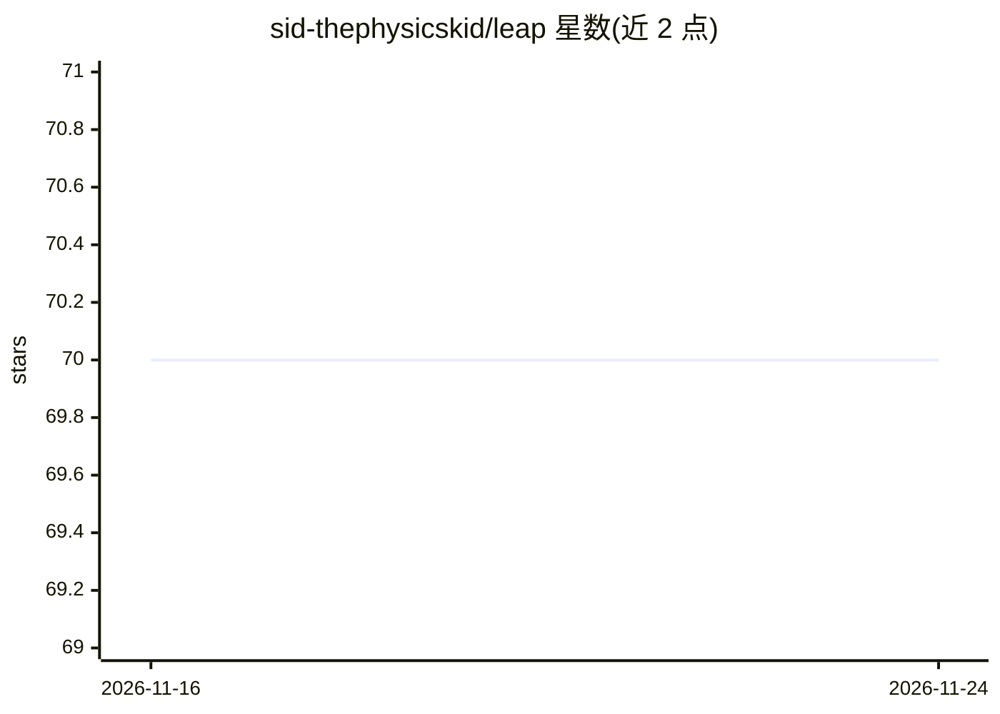

# sid-thephysicskid/leap

⭐ 70 · Jupyter Notebook · Apache-2.0 · 推送 2026-10-28 · [GitHub](https://github.com/sid-thephysicskid/leap) · [官网](https://askleap.ai/) · 个人维护

**AI 教育动画生成器：把任意问题生成为带解说的动画**

开源 Web 应用：用户提交任意主题或问题，系统通过 LangGraph 工作流执行输入校验、场景规划、Manim 代码生成与校验、动画渲染及错误反馈循环，产出带同步解说的教育动画，支持 ELI5/普通/进阶三种讲解深度。前端 React、后端 FastAPI，动画存入 Supabase，完成后经 SendGrid 邮件通知。渲染过程 CPU/内存密集，推荐 Docker Compose 部署（生产用 8 副本加 Nginx 负载均衡），需 OpenAI 与 Supabase API key。

## 筛选速览

| 维度 | 判定 | 备注 |
|---|---|---|
| AI 角色 | `ai-native` | 本体是模型或模型工具 |
| 许可风险 | `permissive` | Apache-2.0 |
| 部署形态 | `self-host` | docker 或自建部署 |
| 模型依赖 | — | README 未给出锁定关系 |
| 硬件要求 | — | 无带数字的原话,不猜 |
| 安装摩擦 | `low` | 无编译、无系统依赖或容器化 |
| 成熟度 | `idea` | |

## 能力要点

- 从文本提示生成任意主题的教育动画（Manim 引擎+同步解说）
- LangGraph 工作流：校验→场景规划→代码生成→渲染→错误反馈循环
- ELI5/普通/进阶三种讲解深度与模糊问题改写建议
- 异步任务、邮件通知、动画存储与播放/分享/评分

## 适用场景

- 把抽象概念或问题变成带解说的动画用于学习
- 按不同知识水平（ELI5 到进阶）获取讲解内容
- 自部署一套动画生成服务供教学使用

## 场景标签

`视频生成` · 领域:内容生成

## 证据(README 行号)

> L21: Leap is an open-source tool to generate animations for any topic or question. Currently it uses the Manim animation
> L67: 3. **Code Generation**: Generates Manim code for the animation
> L69: 5. **Animation Execution**: Renders the animation using Manim

## 星数曲线

2026-11-16 70 → 2026-11-24 70（+0）

---
*卡片 v1 · prompt 1.4 · 生成 2026-11-18 · 置信度 high · 依据 README sha `8d7fb7d4f54a` · [字段定义](../../DATASET.md)*
