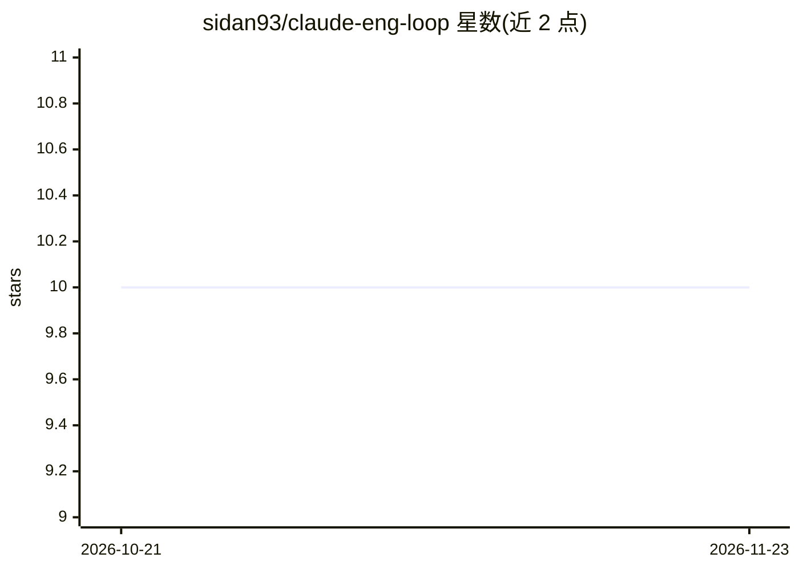

# sidan93/claude-eng-loop

⭐ 10 · MIT · 推送 2026-06-24 · [GitHub](https://github.com/sidan93/claude-eng-loop) · 个人维护

**给 Claude Code 用户的结构化工程流程 CLAUDE.md 模板**

一个可直接放入仓库的 CLAUDE.md 模板文件，为 AI 编码 agent 定义强制性的 9 阶段流程：接收、理解、分解、计划、审查、对齐、执行、验证、目标检查。内置三种执行模式（Interactive/Autonomous/Just Chat）、微任务快速通道、重复失败时的退出机制（escape hatch）与 Project Context 脚手架。安装方式为 curl 下载单文件到仓库根目录或 ~/.claude/。README 明确说明其遵循是概率性的，依赖用户中断与提示提醒来纠正跳阶段行为。

## 筛选速览

| 维度 | 判定 | 备注 |
|---|---|---|
| AI 角色 | `ai-ecosystem` | LLM/agent 周边工具 |
| 许可风险 | `permissive` | MIT |
| 部署形态 | `None` |  |
| 模型依赖 | — | README 未给出锁定关系 |
| 硬件要求 | — | 无带数字的原话,不猜 |
| 安装摩擦 | `low` | 无编译、无系统依赖或容器化 |
| 成熟度 | — | 结构信号不足 |

## 能力要点

- 单文件 CLAUDE.md 定义 9 阶段任务流程与阶段间门控
- 三种执行模式与可独立设置的 Auto mode 组合
- 硬性退出条件：同一 gap 重复出现、区块两次失败、超过 3 轮循环未达目标
- 兼容 MCP servers 与 Superpowers 插件

## 适用场景

- 让 Claude Code 在改代码前先出计划并经我确认
- 给自主运行的 agent 设置重试上限和停止条件
- 把团队工程规范写进 CLAUDE.md 的 Project Context 部分

## 场景标签

`提示工程` `编码 Agent` · 领域:Agent 开发

## 证据(README 行号)

> L9: This is a drop-in `CLAUDE.md` template that defines a mandatory planning process, hard limits on retry loops, and an
> L13: A single `CLAUDE.md` file that defines a mandatory 9-phase process for every task:

## 星数曲线

2026-10-21 10 → 2026-11-23 10（+0）

---
*卡片 v1 · prompt 1.4 · 生成 2026-11-19 · 置信度 high · 依据 README sha `a961a31c359a` · [字段定义](../../DATASET.md)*
